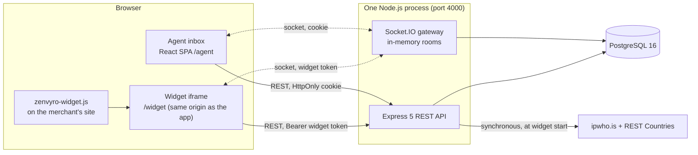
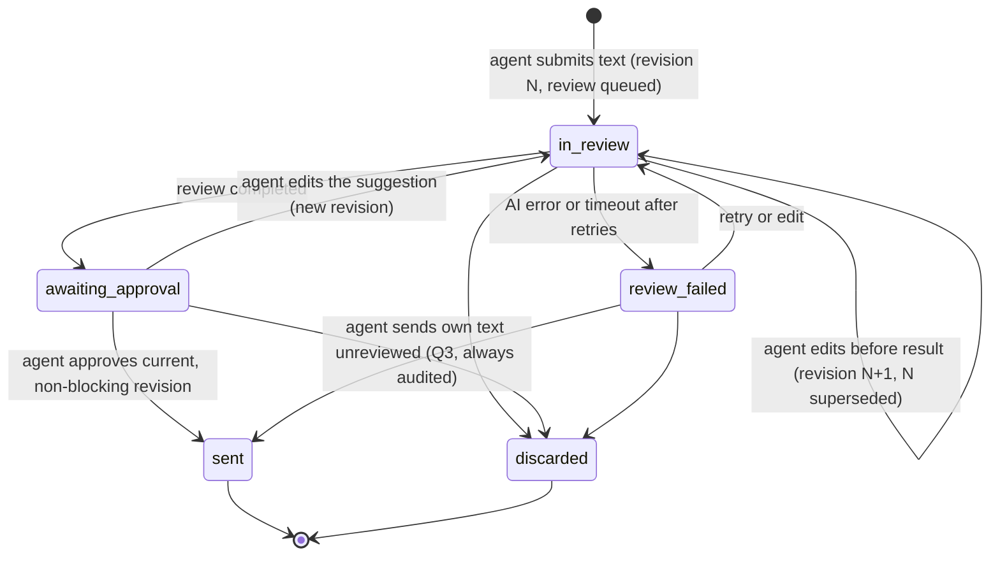
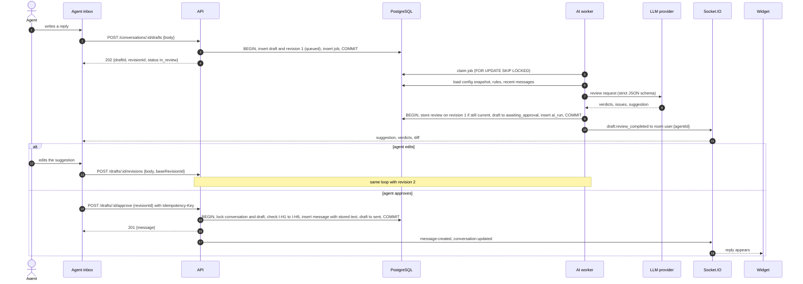
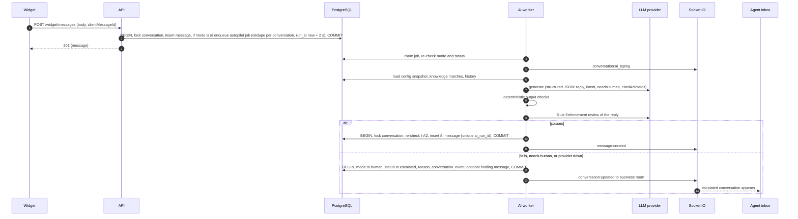
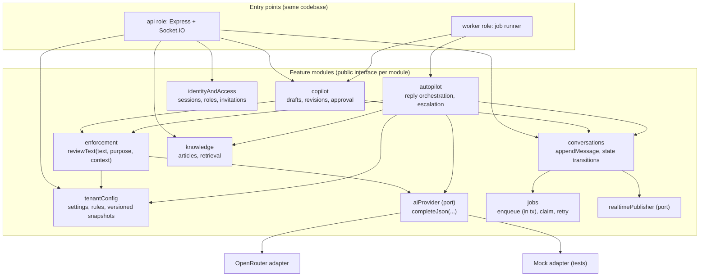

# Zenvyro: Architecture Review and Scalability Roadmap

| | |
|---|---|
| **Date** | 2026-11-23 |
| **Code reviewed** | `saas/` at branch `integration-test`, commit `e3b6c7e` |
| **Brief** | [docs/guideline_system.md](docs/guideline_system.md) |
| **Scope** | Backend (all of `backend/`), database schema and migrations, the frontend parts that change backend load or correctness, project docs, and [docs/System_Design_Philosophy_Guide.pdf](docs/System_Design_Philosophy_Guide.pdf) |
| **Changes made** | None. No source code, schema, or dependency was changed. This file is the only addition. |

**How to read this document.** Every claim about the current code links to the file and line it comes from. Paths are relative to `saas/`. Labels:

- **[EXISTS]**: verified in code and connected to a real request path.
- **[MISSING]**: required by the brief, with no implementation.
- **[PROPOSED]**: a recommendation from this review. Nothing proposed here has been built.
- **[ASSUMPTION]**: a number or premise this review chose. Replace it with real data when you have it.
- **[UNKNOWN]**: could not be determined from the repository.

**Evidence gathered by running things** (not only by reading):

- `npm test` in `backend/`: **7 suites, 101 tests, all passing** (217 s, against the local `saad_test` database).
- `npm run db:migrate`: **fails with `MODULE_NOT_FOUND`**, because `backend/src/db/databaseCommands.js` does not exist.
- OpenRouter free-model limits were checked against current public sources (see [Appendix C](#appendix-c-external-sources)).

---

## Table of contents

1. [Executive Summary](#1-executive-summary)
2. [Product Requirements Overview](#2-product-requirements-overview)
3. [Existing System Architecture](#3-existing-system-architecture)
4. [Current Backend Structure](#4-current-backend-structure)
5. [Database Schema Analysis](#5-database-schema-analysis)
6. [Existing Features vs. Missing Requirements](#6-existing-features-vs-missing-requirements)
7. [Human Support Mode: Architecture Requirements](#7-human-support-mode-architecture-requirements)
8. [AI Support Mode: Architecture Requirements](#8-ai-support-mode-architecture-requirements)
9. [AI Processing and Validation Architecture](#9-ai-processing-and-validation-architecture)
10. [Multi-Tenant Architecture Assessment](#10-multi-tenant-architecture-assessment)
11. [System Design Philosophy: Extracted Principles](#11-system-design-philosophy-extracted-principles)
12. [Scalability Assessment](#12-scalability-assessment)
13. [Identified Bottlenecks and Technical Risks](#13-identified-bottlenecks-and-technical-risks)
14. [Security and Reliability Assessment](#14-security-and-reliability-assessment)
15. [Recommended Architecture Improvements](#15-recommended-architecture-improvements)
16. [Database Changes Required](#16-database-changes-required)
17. [API and Service Changes Required](#17-api-and-service-changes-required)
18. [Background Jobs and Queue Requirements](#18-background-jobs-and-queue-requirements)
19. [Implementation Priority Roadmap](#19-implementation-priority-roadmap)
20. [Questions and Decisions Requiring Product Owner Input](#20-questions-and-decisions-requiring-product-owner-input)
- [Appendix A: Evidence index](#appendix-a-evidence-index)
- [Appendix B: Final verification checklist](#appendix-b-final-verification-checklist)
- [Appendix C: External sources](#appendix-c-external-sources)

---

## 1. Executive Summary

### What exists today

Zenvyro has a **solid, well-tested foundation for human-to-human live chat**. A visitor writes from an embeddable widget, and a staff member answers in real time from a three-pane agent inbox. The backend is a single Node.js process (Express 5 and Socket.IO) on PostgreSQL with raw parameterised SQL. The code is cleanly layered (routes → middleware → controllers → services → repositories), and every staff query is scoped by `business_id`. Session tokens are stored only as SHA-256 hashes. Tests prove tenant isolation over REST and over sockets.

### What does not exist yet

**None of the AI product exists.** The tables `business_rules`, `knowledge_articles`, `message_verifications` and `ai_events` are in [backend/db/schema.sql](backend/db/schema.sql), but **no backend or frontend code references them**. There is no AI provider client, no background job system, no configuration API, no draft or approval workflow, and no autonomous reply pipeline. The `conversations.mode` column (`ai` or `human`) can be changed through `PATCH`, but nothing behaves differently because of it.

### The findings that matter most

| # | Finding | Why it matters |
|---|---|---|
| 1 | **The current message model cannot enforce "no send without human approval".** `POST /api/conversations/:id/messages` inserts and broadcasts in one step ([conversationsService.js:250-278](backend/src/services/conversationsService.js#L250-L278)). `POST /api/conversations` with `firstMessageText` is a second direct path ([conversationsService.js:117-124](backend/src/services/conversationsService.js#L117-L124)). | The critical requirement needs a server-side draft → review → approve state machine. In it, the server sends the *stored, reviewed* text, and the client never resends the body at approval time. |
| 2 | **AI work needs durable asynchronous processing, and none exists.** | LLM calls take seconds, fail, and are rate-limited. They cannot run inside an HTTP request or a fire-and-forget promise. A **PostgreSQL-backed job queue with transactional enqueue** (the outbox pattern) gives durability and exactly-once side effects with **no new infrastructure**. |
| 3 | **Free OpenRouter models cannot run production.** Free `:free` models are capped at 20 requests/minute and 50–1,000 requests/day per account. | Stage 1 alone needs about **10,500 LLM calls/day** ([§12](#12-scalability-assessment)). Free models fit development and demos only. |
| 4 | **The stack cannot be deployed as documented.** `npm run db:migrate` fails, and the `backend` service in [docker-compose.yml:28](docker-compose.yml#L28) runs that command before it starts the server. There is also no migration tracking. | `docker compose up` cannot bring up the API. Every future schema change needs a working, versioned migration path. |
| 5 | **There is no abuse protection.** No route is rate-limited. `POST /api/widget/sessions` is unauthenticated, and each call writes three rows and makes up to two outbound geo-IP calls. | Once AI Mode exists, **every customer message triggers paid LLM calls**. A script can then burn a tenant's (or the platform's) AI budget: "denial of wallet". |
| 6 | **Roles are stored but never enforced, and only owners can exist.** The only user insert hardcodes `'owner'` ([usersRepository.js:3-10](backend/src/repositories/usersRepository.js#L3-L10)). No code checks `role`. | Rules, knowledge, and AI configuration must be admin-only. A business cannot add agents at all today. |
| 7 | **Realtime delivery is at-most-once with no catch-up.** Neither the inbox thread nor the widget refetches after a socket reconnects. | Acceptable for human chat. Not acceptable when a customer is waiting for an AI reply that may arrive during a reconnect. |
| 8 | **Tenant isolation is enforced only in application code.** Foreign keys do not stop a conversation from pointing at another tenant's customer, agent or label. | Composite foreign keys are cheap now (no production data) and expensive later. |

### Recommended direction

Keep the **modular monolith**: one codebase, one PostgreSQL database, and **two or three process roles** (API, realtime, worker) that start from the same code. At every growth stage in the brief, microservices would add network and operational complexity this team does not need ([§11](#11-system-design-philosophy-extracted-principles)). What changes across stages is:

- how many instances run for each role,
- the Socket.IO adapter,
- table partitioning,
- AI provider strategy and per-tenant quotas.

The single most important design move is to put **one Rule Enforcement Service at the centre of both modes**. The service that reviews an agent's draft should also validate every autonomous AI reply. That one module *is* the product's differentiator ([Plan.md](Plan.md)), so it should exist once.

### Product owner decisions

Four questions could change the data model or the provider choice ([§20](#20-questions-and-decisions-requiring-product-owner-input)). All four were decided on 2026-11-23:

1. **Q1, decided:** each staff member belongs to exactly one business. The current `users` model (globally unique email, one `business_id`) stays. No memberships table.
2. **Q2, decided:** customer conversations may be sent to third-party LLM providers. Paid models are still needed for production, for capacity reasons (finding 3), not for privacy reasons.
3. **Q3, decided:** if the AI review is unavailable, the agent may send their own text without review. The server allows this only after it has recorded the review as failed, and it always records the bypass ([§7.4](#74-how-each-consideration-is-handled)).
4. **Q4, decided (option b for now):** no customer identity verification in the first version. The AI answers only general knowledge-base questions and escalates account or order questions to a human. Signed identity is revisited when order lookup is built (R17).

---

## 2. Product Requirements Overview

The brief ([docs/guideline_system.md](docs/guideline_system.md), Part 1) and [Plan.md](Plan.md) describe a multi-tenant AI support SaaS with two operating modes. The requirements are condensed below with IDs, so later sections can refer to them.

### 2.1 Human Support Mode (Copilot)

| ID | Requirement |
|---|---|
| HR-1 | Every agent reply goes through an AI review before it can reach the customer. |
| HR-2 | The review uses the business's rules, policies, guidelines, brand voice, communication standards, knowledge, and extra instructions. |
| HR-3 | The AI corrects grammar, improves clarity and tone, aligns with brand voice, flags and removes policy violations, and preserves the agent's intent. |
| HR-4 | The agent either approves the AI suggestion, or edits it. An edit triggers a new review, and the loop repeats until the agent approves. |
| HR-5 | **Critical:** nothing is sent without explicit human approval while Human Mode is active. |
| HR-6 | Handle: revision cycles, AI failures and timeouts, policy-violating input, meaning changes, concurrent agents, agent disconnects, conversation state, version history, an audit trail (original, revised, approved, sent), duplicate prevention, and approval authorisation. |

### 2.2 AI Support Mode (Autopilot)

| ID | Requirement |
|---|---|
| AR-1 | The AI answers customers autonomously, with no per-message human approval. |
| AR-2 | Context includes: latest message, history, rules, policies, brand guidelines, knowledge, authorised customer data, and business instructions. |
| AR-3 | Evaluate a validation layer: policy compliance, no invented facts, no unauthorised promises, no sensitive disclosure, consistency with history, brand voice. |
| AR-4 | Validated replies are delivered automatically. |
| AR-5 | Handle: low confidence, out-of-knowledge questions, sensitive requests, refunds and cancellations, human-required requests, hallucinations, provider failures, timeouts, escalation, mode switching, and context across mode changes. |

### 2.3 Business configuration and tenancy

| ID | Requirement |
|---|---|
| CR-1 | Each business configures: operating mode, rules, policies, brand voice, knowledge base, AI instructions, escalation rules. |
| CR-2 | Configuration and customer data are isolated between tenants. |
| CR-3 | Evaluate how configuration is stored, versioned, retrieved, cached, and passed to the AI layer. |

### 2.4 Where this review challenges the requirements

The brief asks for critical thinking, so these points push back on the proposed workflow. Each one is resolved in a later section.

| # | Challenge | Resolution |
|---|---|---|
| C1 | **"Edit → AI re-review → repeat until approval" can fail to converge.** An LLM asked to "improve" text will usually change it again, so the agent can bounce between versions and wait several seconds each round. | Instruct the reviewer to make **minimal edits** and to **return the input unchanged when it is already compliant**. Approval binds to a specific reviewed revision. Track the revision-cycle count as a product metric. ([§7](#7-human-support-mode-architecture-requirements)) |
| C2 | **Plan.md says "approve, edit, *or reject*"; the brief says only approve or edit.** If "reject" meant "send my original text instead", it would bypass the review. | "Reject" means *discard the suggestion and keep writing*. Sending text the AI has not reviewed is possible only when the review itself has failed ([Q3](#q3-human-mode-behaviour-when-ai-review-is-unavailable), decided), and it is always audited. Overriding a *completed* review's verdict is a separate question ([Q5](#q5-may-agents-override-a-policy-verdict)). |
| C3 | **A fail-closed review makes the AI provider a hard dependency for human support.** If the LLM is down, no agent can answer any customer. | **Decided ([Q3](#q3-human-mode-behaviour-when-ai-review-is-unavailable)):** when the review has failed after retries, the agent may send their own text, always audited. Reduce the chance of outage with a fallback model chain ([§9.2](#92-provider-port-and-resilience)). |
| C4 | **"Low-confidence AI responses" assumes a reliable confidence number.** LLM self-reported confidence is poorly calibrated. | Escalation decisions combine *observable* signals: knowledge-base match, validator verdict, intent category, explicit "human please", repeated failure. A self-reported score is only one input ([§9.5](#95-escalation-decision)). |
| C5 | **[ROADMAP.md §3](ROADMAP.md) plans a separate intent-classifier call before generation.** That adds one full LLM round trip of latency and cost to every reply. | At Stage 1, return intent and the needs-human flag **inside the structured generation output**. Split it out only if measurements show a benefit. |
| C6 | **"Relevant customer information, when authorised"**: widget visitors are anonymous, and the name and email they type are not verified ([widgetSessionService.js:30-76](backend/src/services/widgetSessionService.js#L30-L76)). | The AI must not use or reveal customer-specific data until the host site passes a **signed identity** ([Q4](#q4-customer-identity-verification), R17). |
| C7 | **Mode switching is treated as a field update** (`PATCH {mode}` in [validateUpdateConversationMiddleware.js:18-24](backend/src/middleware/validateUpdateConversationMiddleware.js#L18-L24)). | A mode change is a domain command with side effects: cancel AI jobs, mark drafts stale, record who did it and why, notify the room. It gets explicit `takeover` and `hand-to-ai` commands (R9). |
| C8 | **Separate validation logic per mode would drift.** | One Rule Enforcement Service validates both human drafts and AI replies (R7). |

---

## 3. Existing System Architecture

### 3.1 Runtime topology [EXISTS]



| Aspect | Current state | Evidence |
|---|---|---|
| Process model | Express and Socket.IO share one HTTP server in one process. The socket server is stored on the Express app so controllers can publish. | [server.js:8-10](backend/src/server.js#L8-L10) |
| Database | One `pg.Pool` with default settings (10 connections, no statement timeout). | [databasePool.js:4-6](backend/src/db/databasePool.js#L4-L6) |
| Realtime | Rooms `business:{id}` and `conversation:{id}`, in memory, so a single instance only. Events are published after the commit, from controllers. | [socketGateway.js:118-146](backend/src/realtime/socketGateway.js#L118-L146), [conversationRealtimePublisher.js](backend/src/realtime/conversationRealtimePublisher.js) |
| Staff authentication | Opaque random token in an HttpOnly, SameSite=Lax cookie. SHA-256 hash in `sessions`. One DB lookup per request. | [requireSessionMiddleware.js:10-40](backend/src/middleware/requireSessionMiddleware.js#L10-L40), [authenticationController.js:4-12](backend/src/controllers/authenticationController.js#L4-L12) |
| Visitor authentication | A public widget key creates customer + conversation + `widget_sessions` row. A 30-day bearer token is kept in `localStorage`. | [widgetSessionService.js:30-76](backend/src/services/widgetSessionService.js#L30-L76) |
| External calls | Geo-IP lookup runs synchronously in the widget-start request, before the transaction, with a 3 s timeout per call (two calls). | [geoOriginService.js:12](backend/src/services/geoOriginService.js#L12), [widgetSessionService.js:35](backend/src/services/widgetSessionService.js#L35) |
| Deployment artefacts | `docker-compose.yml` (postgres + backend), `backend/Dockerfile`. No CI, reverse-proxy, TLS or production hosting configuration in the repository. | [docker-compose.yml](docker-compose.yml), [backend/Dockerfile](backend/Dockerfile) |
| AI | None. `OPENROUTER_API_KEY` and `OPENROUTER_MODEL` are declared in `.env.example` but never read. | [.env.example:34-36](.env.example#L34-L36), [environmentConfig.js](backend/src/config/environmentConfig.js) |

### 3.2 How a message flows today [EXISTS]

1. The visitor posts `POST /api/widget/messages`. The service locks the conversation row (`SELECT … FOR UPDATE`), reopens it if it was `resolved`, inserts the message, and updates `last_message_at` in one transaction ([widgetSessionService.js:119-159](backend/src/services/widgetSessionService.js#L119-L159)).
2. After the commit, the controller emits `message:created` to `conversation:{id}`. It then **re-reads the conversation** and emits `conversation:updated` to `business:{id}` ([widgetController.js:34-50](backend/src/controllers/widgetController.js#L34-L50)).
3. The agent posts `POST /api/conversations/:id/messages`. The service locks the row, refuses with `409` if the conversation is resolved, inserts, and commits. The controller then publishes ([conversationsService.js:250-278](backend/src/services/conversationsService.js#L250-L278), [conversationsController.js:76-94](backend/src/controllers/conversationsController.js#L76-L94)).

What this flow does right: it locks the conversation row, publishes only after commit, and never pushes a message that was rolled back.

What it lacks: it has no idempotency, and if the follow-up read after the commit fails, the client receives a `500` for a message that *was* saved. A retry then produces a duplicate (R4).

---

## 4. Current Backend Structure

```
backend/
├── src/
│   ├── server.js                  HTTP server + Socket.IO attach (16 lines)
│   ├── app.js                     Express app, CORS split (widget vs staff), routes, 404, error handler
│   ├── config/                    environmentConfig.js (frozen config object), .env loader
│   ├── db/                        databasePool.js only. databaseCommands.js (migrate/seed) is MISSING
│   ├── routes/          (5)       authentication, conversations, labels, users, widget
│   ├── middleware/      (15)      one validator per endpoint, session checks, error handler
│   ├── controllers/     (5)       read validated input, call one service, publish realtime, respond
│   ├── services/        (7)       business logic and transactions; geo-origin; token hashing
│   ├── repositories/    (8)       raw parameterised SQL, one module per table; executor = pool or tx client
│   ├── realtime/        (4)       gateway (auth, rooms), publisher, room and event names
│   └── utils/           (5)       ApplicationError, input validation, keyset cursors, enum values
├── db/
│   ├── schema.sql                 full baseline schema (16 tables)
│   ├── seed.sql                   demo business "Acme Shoes"
│   └── migrations/                001 (inbox index), 002 (widget_sessions): both duplicate schema.sql
└── tests/           (7 suites)    Jest + Supertest + socket.io-client against a real Postgres database
```

### 4.1 Patterns in use [EXISTS]

| Pattern | Where | Assessment |
|---|---|---|
| Layered architecture (PDF ch. 3) | routes → middleware → controllers → services → repositories | Consistent across every endpoint. A good base. |
| Repository with an injectable executor | `repositoryFunction(databaseExecutor, …)`, for example [conversationsRepository.js:52](backend/src/repositories/conversationsRepository.js#L52) | Lets one service compose several repositories in one transaction. Keep it. |
| Validated input objects | Middleware sets `request.validatedBody` and `request.validatedQuery` | Clear contract between layers. |
| Pessimistic locking of the conversation | [conversationsRepository.js:72-81](backend/src/repositories/conversationsRepository.js#L72-L81) | Correct tool for "status check + insert" races. Reuse it for approvals. |
| Publish after commit | Controllers call the publisher after the service returns | Correct ordering. It lives in controllers, so workers cannot reuse it (R3). |
| Keyset pagination with a tie-breaking id | [paginationCursor.js](backend/src/utils/paginationCursor.js), [conversationsRepository.js:110-116](backend/src/repositories/conversationsRepository.js#L110-L116) | Scales. Tested for ties ([conversations.test.js:213](backend/tests/conversations.test.js#L213)). |
| Expected-error type | [applicationError.js](backend/src/utils/applicationError.js), [errorHandlerMiddleware.js](backend/src/middleware/errorHandlerMiddleware.js) | Never leaks SQL. It also **logs only `error.message`**, with no stack trace or request id ([errorHandlerMiddleware.js:16](backend/src/middleware/errorHandlerMiddleware.js#L16)). |
| Injectable side effect for tests | `detectOriginForIpAddress(ip, { fetchFunction })` ([geoOriginService.js:101](backend/src/services/geoOriginService.js#L101)) | The right pattern for the future AI provider (a port with adapters). |

### 4.2 Structural weaknesses

| Weakness | Evidence | Consequence once AI is added |
|---|---|---|
| **Message-append logic exists twice.** Staff path: `insertMessageAndTouchConversation`. Visitor path: an inline insert plus touch plus reopen. | [conversationsService.js:96-100](backend/src/services/conversationsService.js#L96-L100) vs [widgetSessionService.js:119-159](backend/src/services/widgetSessionService.js#L119-L159) | AI replies, system messages and approved drafts would add a third and fourth copy. Rules such as locking, sequencing, idempotency and the job outbox would drift apart. |
| **Side effects are orchestrated in controllers.** Realtime publishing goes through `request.app.get('socketServer')`. | [conversationsController.js:85-92](backend/src/controllers/conversationsController.js#L85-L92) | A background worker has no `request`. It cannot publish without the logic being duplicated. |
| **Module-level singletons.** Services import `pool` directly. | for example [conversationsService.js:1](backend/src/services/conversationsService.js#L1) | Acceptable today. For AI services, inject the provider and the clock so they can be tested without network or time (PDF ch. 1–2: dependency injection). |
| **No state machine for conversation status or mode.** Any status can move to any status. | [validateUpdateConversationMiddleware.js:10-24](backend/src/middleware/validateUpdateConversationMiddleware.js#L10-L24), [conversationsRepository.js:131-150](backend/src/repositories/conversationsRepository.js#L131-L150) | Escalation and mode transitions have side effects that must run on the correct transitions only. |
| **Organised by technical layer, not by feature.** | directory tree above | Fine at today's size. As copilot, autopilot, enforcement, knowledge and config modules arrive, feature modules with small public interfaces keep cohesion high (R27). |

**Testability: good.** Tests hit a real database, cover tenant isolation over REST ([conversations.test.js:415-456](backend/tests/conversations.test.js#L415-L456)) and sockets ([realtime.test.js:130](backend/tests/realtime.test.js#L130)), and stub all network calls. There are gaps:

- No tests for authorisation by role, because no role checks exist.
- No tests for concurrent double-submit or rate limits.
- The test database is created from `schema.sql` **only if `users` is missing** ([databaseTestHelper.js:10-15](backend/tests/helpers/databaseTestHelper.js#L10-L15)), so new migrations silently never reach an existing test database.
- The suite takes 217 s. bcrypt cost 12 on every sign-up ([authenticationService.js:14](backend/src/services/authenticationService.js#L14)) is a likely contributor [ASSUMPTION: not profiled].

---

## 5. Database Schema Analysis

Source: [backend/db/schema.sql](backend/db/schema.sql) (16 tables, PostgreSQL 16, `pgcrypto`-style `gen_random_uuid()`, `pg_trgm` enabled but unused).

### 5.1 Entities and their use

| Table | Purpose | Used by code? | Tenant key | Notes |
|---|---|---|---|---|
| `businesses` | Tenant root | **Yes** | itself | `brand_tone` text and `settings` jsonb exist ([schema.sql:12-13](backend/db/schema.sql#L12-L13)). Neither is read or written by any code. |
| `users` | Staff | **Yes** | `business_id` | `email` is **globally** `UNIQUE` ([schema.sql:30](backend/db/schema.sql#L30)), so one person cannot work for two businesses. `role` is stored and never checked. |
| `sessions` | Staff sessions | **Yes** | via `users` | Hashed token, `expires_at` index. No cleanup job. |
| `customers` | End customers | **Yes** | `business_id` | No unique key on `(business_id, external_id)` or email. Dedupe is a non-atomic read-then-insert ([customersRepository.js:14-26](backend/src/repositories/customersRepository.js#L14-L26)). The widget creates a new customer per session. |
| `conversations` | Threads | **Yes** | `business_id` | `mode`, `status` (incl. `escalated`), `assigned_agent_id`, origin columns. `team_id`, `category`, `sentiment`, `csat_score` are **unused**. |
| `messages` | Sent messages | **Yes** | **none**: only via `conversation_id` | `original_body` is **never written** ([schema.sql:98](backend/db/schema.sql#L98)). `sender_id` has no FK (it points at either a customer or a user). No lifecycle, idempotency key, or sequence. |
| `widget_sessions` | Visitor sessions | **Yes** | `business_id` | Hashed token, 30-day expiry, no cleanup job. |
| `labels`, `conversation_labels` | Inbox organisation | **Yes** | `business_id` / via conversation | Same-tenant check happens in the service ([conversationsService.js:208-213](backend/src/services/conversationsService.js#L208-L213)), not in the DB. |
| `business_rules` | Rules for enforcement | **No** | `business_id` | No versioning. |
| `knowledge_articles` | Knowledge base | **No** | `business_id` | Generated `tsvector` with `'english'` config only, GIN index without `business_id`. |
| `message_verifications` | Copilot review results | **No** | **none** | One row per verification with no revision chain, review status, author, model, prompt or config version (see 5.4). |
| `ai_events` | AI audit trail | **No** | `business_id` | No prompt or config version, token counts, status, error, or retention marker. |
| `teams`, `canned_responses`, `internal_notes` | Post-MVP features | **No** | `business_id` / via conversation | Out of scope for Part 1. They are not reviewed further. |

### 5.2 Tenant isolation mechanisms

- **[EXISTS]** Every repository query on tenant data filters by `business_id`, either directly or through a conversation that was checked first. Comments document this rule ([conversationsRepository.js:2](backend/src/repositories/conversationsRepository.js#L2), [messagesRepository.js:2](backend/src/repositories/messagesRepository.js#L2)).
- **[EXISTS]** Cross-tenant references are prevented **in services**: assignee ([conversationsService.js:177-182](backend/src/services/conversationsService.js#L177-L182)), labels ([conversationsService.js:208-213](backend/src/services/conversationsService.js#L208-L213)), customer on create ([conversationsService.js:109-114](backend/src/services/conversationsService.js#L109-L114)).
- **[MISSING]** The database does not enforce any of these. `conversations.customer_id`, `conversations.assigned_agent_id`, and `conversation_labels.label_id` are plain single-column FKs, so a bug in a future code path (for example an AI worker) can link rows across tenants.
- **[MISSING]** No Row-Level Security. No `business_id` on `messages`, `conversation_labels`, `message_verifications` or `internal_notes`.

### 5.3 Indexes and constraints

| Present | Assessment |
|---|---|
| `conversations (business_id, last_message_at DESC, id DESC)` | Matches the inbox keyset query. Good. |
| `conversations (business_id, status)`, `(business_id, assigned_agent_id)` | These cannot serve "status = open ORDER BY last_message_at". For a tenant with many resolved conversations, the planner scans the recency index and filters (R26). |
| `messages (conversation_id, created_at)` | Serves the thread query. The keyset uses `(created_at, id)`; adding `id` (or a sequence) makes the cursor exact (R26). |
| GIN on `knowledge_articles.search_vector` | Not combined with `business_id`. At 10,000 tenants every search scans all tenants' matches and then filters (R26). |
| CHECK constraints on enums and token-hash formats | Good defensive practice. Keep it for new tables. |

### 5.4 Gaps against Part 1 requirements

| Area | Gap | Problem it causes |
|---|---|---|
| **Message lifecycle** | `messages` only holds sent messages, which is correct, but there is **no draft entity**. | HR-4/HR-5 need a place where unsent text, its AI review, and its approval live, apart from what the customer can see. |
| **Approval workflow** | No approval record, no link from a sent message to the reviewed revision it came from. | You cannot prove that a sent message was approved, or by whom (HR-6 audit). You cannot block a second send of the same approval. |
| **AI processing state** | No job or run status (queued, processing, failed, superseded). | You cannot recover after an agent disconnects or a server restarts. You cannot show "reviewing…" reliably. You cannot retry safely. |
| **Version history** | `message_verifications` stores one original and one suggestion per row, with no chain. | You cannot reconstruct "agent wrote A → AI suggested B → agent edited C → AI suggested D → approved D". |
| **Audit history** | No record of mode, status or assignment changes, or of who made them. | You cannot answer "who switched this to AI mode, and when?" or "why was this escalated?". |
| **Conversation state** | `status = escalated` exists, but there is no `escalation_reason` or `escalated_at`, and no business default `mode`. | Escalation analytics and routing are impossible. Every widget conversation starts in `human` mode ([schema.sql:66](backend/db/schema.sql#L66)). |
| **Configuration** | Rules exist as rows. Brand voice is one text field. AI instructions and escalation rules have no home. Nothing is versioned. | You cannot reproduce which rules produced a given AI reply, and caches cannot be invalidated safely. |
| **Duplicate prevention** | No idempotency key on messages. No unique link to the AI run or approved revision that produced a message. | Retries (client, job, network) create duplicate customer-visible messages. |
| **Ordering and catch-up** | No per-conversation sequence number. | Clients cannot detect gaps after a reconnect. |
| **Permissions** | Three roles, no membership table, no invitations. | No multi-agent teams. No admin-only configuration. |
| **Customer identity** | No verified-identity concept. | AR-2's "authorised customer data" cannot be honoured safely (C6). |

### 5.5 Migration state [MISSING]

- [package.json:13-14](backend/package.json#L13-L14) and [docker-compose.yml:28](docker-compose.yml#L28) call `node src/db/databaseCommands.js`, which does not exist. Running it was verified to fail.
- There is no `schema_migrations` table, although [ROADMAP.md §4](ROADMAP.md) calls for one.
- Migrations `001` and `002` duplicate objects already in `schema.sql` (made safe with `IF NOT EXISTS`). The README states that the runner is pending and documents loading SQL by hand ([README.md](README.md), "Create the development schema").

---

## 6. Existing Features vs. Missing Requirements

Each entry gives the status, then: what exists, where, what is missing, what must change, and whether the current approach is architecturally suitable.

### Foundation

**F1. Business sign-up and tenant creation: IMPLEMENTED**
- *Exists:* one transaction creates the business, its owner, and the first session. Random slug and widget key.
- *Where:* [authenticationService.js:56-90](backend/src/services/authenticationService.js#L56-L90).
- *Missing:* none for Part 1.
- *Change:* none.
- *Suitable:* yes.

**F2. Staff authentication and sessions: IMPLEMENTED**
- *Exists:* sign-up, sign-in, me, sign-out. Hashed opaque tokens. Constant-time-ish unknown-email path.
- *Where:* [authenticationService.js](backend/src/services/authenticationService.js), [requireSessionMiddleware.js](backend/src/middleware/requireSessionMiddleware.js).
- *Missing:* expired-session cleanup. Socket disconnect on revocation (R16). Sign-in rate limiting (R12).
- *Suitable:* yes.

**F3. Staff management and roles: NOT IMPLEMENTED (roles stored only)**
- *Exists:* a `role` column. A list endpoint `GET /api/users`.
- *Where:* [schema.sql:32](backend/db/schema.sql#L32), [usersRepository.js:3-10](backend/src/repositories/usersRepository.js#L3-L10) (the only insert, hardcoded `'owner'`).
- *Missing:* inviting admins and agents, any role check.
- *Change:* invitations and role middleware (R11).
- *Suitable:* yes. One business per staff member is confirmed ([Q1](#q1-can-a-staff-member-belong-to-several-businesses)), so the current `users` model stays.

**F4. Embeddable widget and anonymous visitor sessions: IMPLEMENTED**
- *Exists:* loader script, isolated iframe, a 30-day token in `localStorage`, history restore.
- *Where:* [widgetSessionService.js](backend/src/services/widgetSessionService.js), [frontend/public/zenvyro-widget.js](frontend/public/zenvyro-widget.js), [useWidgetChat.js](frontend/src/hooks/useWidgetChat.js).
- *Missing:* rate limits, a per-business allowed-origins list, key rotation, verified identity.
- *Change:* R12, R17, R20.
- *Suitable:* yes. The socket also opens on every page view for returning visitors, even with the chat closed (see R25).

**F5. Real-time messaging: IMPLEMENTED (single instance, no catch-up)**
- *Exists:* conversation and business rooms, a socket-auth split between staff and visitors, publish after commit, tests.
- *Where:* [socketGateway.js](backend/src/realtime/socketGateway.js), [realtime.test.js](backend/tests/realtime.test.js).
- *Missing:* missed-event recovery after reconnect. A multi-instance adapter. Per-user rooms (needed for review results).
- *Change:* R15, R16, R24.
- *Suitable:* yes for Stage 1. It needs an adapter at Stage 2.

**F6. Conversation management (list, filter, assign, labels, status): IMPLEMENTED**
- *Exists:* keyset pagination, views (mine, unassigned, all), status and mode filters, assignee and labels with same-tenant checks.
- *Where:* [conversationsService.js](backend/src/services/conversationsService.js), [conversationsRepository.js](backend/src/repositories/conversationsRepository.js).
- *Missing:* status transition rules. An audit of changes. The inbox UI still polls every 20 s instead of using the existing business-room events ([useConversationList.js:5](frontend/src/hooks/useConversationList.js#L5)).
- *Change:* R9, R15.
- *Suitable:* yes.

**F7. Customer origin detection: IMPLEMENTED**
- *Exists:* IP lookup and country enrichment with graceful fallback.
- *Where:* [geoOriginService.js](backend/src/services/geoOriginService.js).
- *Missing:* nothing functional.
- *Change:* move it out of the request path (up to 6 s added to widget start). Add an IP cache. Review the privacy implications of sending IPs to a free third party (R22, [Q11](#q11-data-retention-deletion-and-residency)).
- *Suitable:* yes, with that change.

### Human Support Mode

**F8. AI review of agent drafts: NOT IMPLEMENTED**
- *Exists:* an unused `message_verifications` table. A `reviewPanel` slot in the composer ([ReplyComposer.jsx:15-17](frontend/src/components/inbox/ReplyComposer/ReplyComposer.jsx#L15-L17)).
- *Missing:* everything: provider, prompt, endpoint, job, storage.
- *Change:* R2, R5, R6, R7.
- *Suitable:* the existing table is not adequate (see 5.4). Reshape it now, while it holds no data.

**F9. Server-side "no send without approval": NOT IMPLEMENTED**
- *Exists:* direct send at [conversationsService.js:250-278](backend/src/services/conversationsService.js#L250-L278). Direct first message at [conversationsService.js:117-124](backend/src/services/conversationsService.js#L117-L124).
- *Missing:* drafts, approval, enforcement.
- *Change:* R2. Close both bypasses.
- *Suitable:* no. The endpoint contract must change.

**F10. Draft version history and audit trail: NOT IMPLEMENTED**
- *Exists:* none. `messages.original_body` is unused.
- *Change:* R2 (revisions), R9 (conversation events), R14 (AI runs).

**F11. Concurrency control for agents: PARTIALLY IMPLEMENTED**
- *Exists:* a row lock on message post and label replace.
- *Where:* [conversationsService.js:204](backend/src/services/conversationsService.js#L204), [conversationsService.js:256](backend/src/services/conversationsService.js#L256).
- *Missing:* draft ownership, optimistic versioning, "who may send" rules.
- *Change:* R2.
- *Suitable:* the locking approach is right. Reuse it.

**F12. Duplicate delivery prevention: PARTIALLY IMPLEMENTED**
- *Exists:* clients merge realtime messages by id ([useWidgetChat.js](frontend/src/hooks/useWidgetChat.js), `mergeMessagesById`).
- *Missing:* server-side idempotency keys and unique constraints. Avoiding a `500` after commit.
- *Change:* R4.
- *Suitable:* client-side merge is necessary but not sufficient.

### AI Support Mode

**F13. Autonomous AI replies: NOT IMPLEMENTED**
- *Exists:* `mode = 'ai'` can be set; nothing reacts to it.
- *Where:* [conversationValues.js:3](backend/src/utils/conversationValues.js#L3).
- *Change:* R5, R6, R8.

**F14. Response validation layer: NOT IMPLEMENTED**
- *Change:* R7 (shared with F8), R21.

**F15. Escalation to human: PARTIALLY IMPLEMENTED (status value only)**
- *Exists:* `escalated` status, settable manually through `PATCH`. UI status pill.
- *Missing:* an AI trigger, a reason, a timestamp, notification, routing.
- *Change:* R8, R9.

**F16. Mode switching with context preserved: PARTIALLY IMPLEMENTED**
- *Exists:* `PATCH {mode}` with no role check, audit or side effects. History is naturally shared because both modes write to `messages`.
- *Missing:* job cancellation, draft invalidation, business default mode, handoff summary.
- *Change:* R9, R10.

**F17. Refunds, cancellations and actions needing authorisation: NOT IMPLEMENTED**
- *Exists:* the DummyJSON base URL in `.env.example` only.
- *Change:* R17 (`action_requests` with human approval; no autonomous side effects).

### Business configuration

**F18. Business rules: NOT IMPLEMENTED (table only)**. *Change:* CRUD (admin), versioning (R10).

**F19. Knowledge base: NOT IMPLEMENTED (table and index only)**. *Change:* CRUD, search, retrieval in context (R10). Semantic search later (R31).

**F20. Brand voice, AI instructions and escalation rules: NOT IMPLEMENTED**
- *Exists:* the `brand_tone` default and an empty `settings`.
- *Change:* a typed settings table plus versioned snapshots (R10).

**F21. Operating mode per business: NOT IMPLEMENTED**
- *Exists:* per-conversation only, defaulting to `human`.
- *Change:* R10.

**F22. Configuration versioning and caching: NOT IMPLEMENTED**. *Change:* R10.

### Platform

**F23. AI provider integration: NOT IMPLEMENTED**. *Change:* R6.

**F24. AI audit and usage logging: NOT IMPLEMENTED**. *Change:* R14 (reshape `ai_events`).

**F25. Background jobs and queue: NOT IMPLEMENTED**. *Change:* R5.

**F26. Tenant isolation: IMPLEMENTED (application level), PARTIALLY (database level)**
- *Exists:* see 5.2.
- *Change:* R13 (composite FKs, `business_id` on messages), R28 (RLS).

**F27. Rate limiting and abuse protection: NOT IMPLEMENTED**. *Change:* R12.

**F28. Migrations tooling: NOT IMPLEMENTED (documented as pending)**. *Change:* R1.

**F29. Observability and health checks: NOT IMPLEMENTED**. *Change:* R18.

**F30. Production hosting, TLS, backups and disaster recovery: NEEDS VERIFICATION**
- *Exists:* nothing in the repository describes production hosting, database backups, or restore procedures.
- *Change:* confirm the plan ([Q12](#q12-hosting-backups-and-availability-target)).

**F31. Multi-instance realtime behaviour: NEEDS VERIFICATION**
- No adapter is configured, so it would not work today. Socket.IO's HTTP long-polling transport requires sticky sessions behind a load balancer. Nothing in the repository configures either. Verify once a hosting target is chosen.

---

## 7. Human Support Mode: Architecture Requirements

### 7.1 Invariants the server must enforce

These are checked **inside the database transaction that inserts the message**, not in the UI:

1. **I-H1.** In Human Mode, an agent-authored customer-visible message can only be created from a **draft revision whose AI review completed**, through the approve command. The one exception is the review-failure path decided in [Q3](#q3-human-mode-behaviour-when-ai-review-is-unavailable): if the server recorded the current revision's review as `failed`, the agent may send that revision's own text through the `send-unreviewed` command, which is always audited.
2. **I-H2.** The text sent is always **server-stored**: the `suggested_body` of the approved revision, or the `input_body` on the review-failure path. The request carries a `revisionId`, never a body, so a tampered client cannot swap the text.
3. **I-H3.** Only the **current** revision of a draft can be approved. Approving a superseded revision fails with `409`.
4. **I-H4.** A revision marked **blocking** (a critical or high-severity policy failure the AI could not fix) cannot be approved.
5. **I-H5.** The approver must be the draft's author, belong to the same business, and be allowed to send in this conversation (assignee, or `admin`/`owner`; see [Q6](#q6-who-may-approve-and-send-in-a-conversation)). The conversation must be `mode = human` and not `resolved`. It is locked `FOR UPDATE`.
6. **I-H6.** One revision produces **at most one** message: a unique constraint on `messages.source_draft_revision_id`. The draft moves to `sent` in the same transaction.
7. **I-H7.** Every step is append-only and auditable: each revision (input text, suggestion, verdicts, model, prompt version, config version), the approval (who, when), and the sent message (linked back).

### 7.2 Domain model [PROPOSED]

- **Draft**: one agent's in-progress reply in one conversation. Holds a status and a pointer to the current revision. At most one active draft per agent per conversation.
- **Revision**: an immutable snapshot of text submitted for review: either the agent's original text, or the agent's edit of a suggestion. Its review result is written once.
- **Review**: the output of the Rule Enforcement Service for one revision: verdicts (grammar, policy, tone), issues, suggestion, `is_meaning_preserved`, `is_blocking`.
- **Approval**: the agent's command to send the current revision's suggestion. It is recorded on the draft and linked from the sent message.



A draft is **not** blocked when the customer writes again while it is in review. It gets a **staleness flag**: the revision records the newest message id it was reviewed against, and the UI warns "the customer wrote again since this was reviewed". Blocking would frustrate agents in fast chats, while a warning keeps the human in control.

### 7.3 Flow [PROPOSED]



Why asynchronous (`202` plus a push) instead of holding the HTTP request open for the review:

- An LLM call takes seconds and may be retried. Holding requests open ties up connections and fails if the agent's network drops.
- A persisted job survives an agent disconnect or a server restart. The UI simply re-reads `GET /drafts/:id` on reconnect.
- The same job runner serves AI Mode, so there is one mechanism to operate.

The trade-off is a little more client logic (show "reviewing…", listen for the push, fall back to polling the draft), which is cheap.

### 7.4 How each consideration is handled

| Consideration | Recommended handling | Why this and not something heavier |
|---|---|---|
| **Multiple revision cycles** | Unlimited by default. The reviewer is instructed to make minimal edits and to return unchanged, compliant text with `changes: []`, so a converged revision is approved in one click. Track cycles per sent message. Show a hint after 3 cycles. | A hard cap would strand an agent with an unsendable reply. Convergence is a prompt-design property, so measure it ([Q7](#q7-revision-cycle-limit)). |
| **AI failure or timeout** | The job retries with backoff and a fallback model inside a **latency budget** [ASSUMPTION: 20 s]. After that the draft is `review_failed`. The agent can retry, edit, or **send their own text without review** ([Q3](#q3-human-mode-behaviour-when-ai-review-is-unavailable), decided). The server offers that last option only for a revision whose review it recorded as failed, so a working review cannot be skipped. Deterministic checks ([§9.4](#94-validation-layers-cheapest-first)) still run, because they need no AI. Every such send writes a `review_bypassed` event, and the message stays linked to its failed revision. | Customers keep getting answers during an AI outage. The agent's click is still the explicit human approval HR-5 requires, and admins can list every unreviewed message afterwards. |
| **Invalid or policy-violating human text** | The review returns `policy_status = failed` plus a compliant suggestion. If no compliant rewrite preserves the intent, `is_blocking = true` and approve is refused. | The agent learns why, and the platform never forwards a known violation. |
| **AI changes the meaning** | The review output includes `is_meaning_preserved` and a list of `changes`, each with a reason and the rule it cites. The UI shows a diff. The agent can edit, which triggers a re-review. | The human stays the final authority on intent. No second "meaning checker" model is needed at Stage 1. |
| **Concurrent agent edits** | Drafts are per agent. Each draft has a `lock_version`. Edit and approve carry `baseRevisionId`, and a stale value returns `409`. Sending locks the conversation row (as today). After a send, other agents' drafts are flagged "conversation changed". | Optimistic per-draft concurrency plus the existing row lock. No collaborative editing or CRDTs, because two agents rarely co-write one reply. |
| **Agent disconnects during processing** | The review is a persisted job, and its result is stored regardless of the connection. On reconnect the UI loads active drafts with `GET /conversations/:id/drafts?mine=true`. | Durable state on the server, not the socket. |
| **Conversation state management** | Approve checks `mode = human` and `status != resolved` under the lock. A switch to AI mode marks open drafts `discarded` (reason `mode_changed`) in the same transaction. | Keeps state transitions atomic, where the existing lock already provides isolation. |
| **Message version history** | `message_draft_revisions` is append-only. `messages.source_draft_revision_id` links each sent message to its reviewed origin. | Gives the useful part of event sourcing (full history) without event-sourcing the system ([§11](#11-system-design-philosophy-extracted-principles)). |
| **Audit logs** | Original text, AI suggestion and verdicts (revision rows), approval (draft row: who, when, which revision), sent text (message), AI call metadata (`ai_runs`), overrides (`conversation_events`). | Answers every "who approved what, based on which rules?" question with SQL. |
| **Duplicate delivery** | The approve request carries an `Idempotency-Key`. The DB has a unique `source_draft_revision_id`. A repeated approve returns the existing message with `200`. The realtime push is notification only, and clients merge by id. | The PDF's idempotency pattern (ch. 6), enforced by the database rather than by hope. |
| **Only authorised agents approve** | Role middleware (R11) plus the in-transaction check I-H5. | Defence in depth: the route guard and the domain check. |

### 7.5 What not to build (overengineering guard)

- No per-keystroke or streaming review. Review on submit only.
- No separate approval microservice or workflow engine. The state machine is about 6 states in one table.
- No multi-agent co-editing of one draft.
- No second LLM to judge the first reviewer at Stage 1. Use a golden test set instead ([§9.8](#98-testing-strategy)).

---

## 8. AI Support Mode: Architecture Requirements

### 8.1 Invariants

1. **I-A1.** An AI reply is generated **asynchronously** after the customer's message commits. The customer's HTTP request never waits for the LLM.
2. **I-A2.** Before inserting the reply, the worker re-checks **under the conversation row lock** that the conversation is still `mode = ai`, still not resolved, and that **no newer customer message arrived** after the one it answered. If any check fails, the reply is discarded and, where relevant, the job is re-queued.
3. **I-A3.** One AI run produces at most one message (unique `messages.ai_run_id`), so a retried job cannot double-reply.
4. **I-A4.** Every AI reply passes the **same Rule Enforcement Service** as human drafts. A failed high-severity check never reaches the customer.
5. **I-A5.** The AI has **no side-effecting tools** (refunds, cancellations). It can only *request* an action that a human approves (R17).
6. **I-A6.** The AI uses customer-specific data only when the customer's identity is verified (C6, R17).

### 8.2 Pipeline [PROPOSED]



The 2-second `run_at` delay and per-conversation dedupe **coalesce bursts**: customers often send two or three short messages in a row. One reply to all of them is better, and cheaper, than three replies racing each other. [ASSUMPTION: 2 s; tune with real data.]

### 8.3 Is a separate validation layer needed?

**Yes, but it should be the same Rule Enforcement Service used for drafts, not a new subsystem.**

| Option | Pros | Cons | Verdict |
|---|---|---|---|
| A. Trust the generator (rules in its prompt only) | Fastest, cheapest (1 call) | The model that broke a rule judges itself. Injection in the customer message can override the prompt. Weakest compliance story. | Reject. It contradicts the product's promise. |
| B. Deterministic checks only (regex, PII, allowlists) | Cheap, predictable | Cannot judge "promises a refund", "guarantees delivery", or tone. | Necessary, not sufficient. |
| **C. Deterministic checks plus an independent LLM review with the shared verifier** | The verifier sees only the reply, the rules and minimal context, so it is harder to inject through the customer's text. One implementation for both modes. | About 2× LLM calls per reply, plus 1–4 s of latency. | **Recommended for Stages 1–2.** Correctness is the product. |
| D. C plus a second judge, or self-consistency voting | Higher assurance | 3× or more cost and latency | Not now. Revisit only for tenants whose risk profile justifies it. |

**Repair policy for Option C:**

- *Pass*: send the generator's reply.
- *Needs improvement* (tone or grammar, no high-severity rule): send the verifier's suggestion.
- *Fail* on a high or critical rule: escalate.

The verifier's suggestion is itself LLM output. It is still checked by the deterministic guards, but not by a second LLM review. This is a deliberate cost and latency trade-off.

### 8.4 How each consideration is handled

| Consideration | Recommended handling |
|---|---|
| **Low-confidence answers** | Escalate based on composite signals ([§9.5](#95-escalation-decision)), not on a single self-reported score (C4). |
| **Questions outside the knowledge base** | If the intent needs facts and retrieval returns nothing above a threshold, the reply follows the business's configured fallback ("I'll check with the team") and the conversation escalates. The AI never answers factual questions from general model knowledge about the business. |
| **Sensitive requests** (legal threats, self-harm, harassment, data deletion, account security) | Platform-level sensitive-intent list, plus business-level escalation rules. Immediate escalation with a configurable holding message. |
| **Refunds and cancellations** | The AI never executes them. It may create an `action_request` (pending human approval) and tell the customer it was forwarded. Executing with limits and idempotency keys towards the e-commerce system is a later phase, behind a provider port. |
| **Requests for a human** | Detected in the structured output (`needsHuman`). Escalate immediately. |
| **Hallucinations** | Grounding: factual claims must cite retrieved article ids or authorised data, and the verifier checks "claims not supported by the provided context". Retrieved text is the only source of business facts. |
| **AI provider failures** | Retry with backoff and jitter. Fallback model chain. Circuit breaker per model. After the budget, escalate with a holding message. Never leave the customer unanswered. |
| **Generation timeouts** | Per-call timeout plus an end-to-end budget [ASSUMPTION: p95 ≤ 10 s, hard stop 25 s]. A typing indicator while running. Escalate on budget exhaustion. |
| **Escalation to human support** | Sets `mode = human`, `status = escalated`, `escalated_at`, `escalation_reason`. Records a `conversation_event`. Generates a handoff summary job (P2). Notifies the business room. Routing to teams is later. |
| **Switching modes** | Explicit commands: `takeover` (an agent claims an AI conversation: mode to human, self-assigned) and `hand-to-ai`. Each runs in one transaction with job cancellation and draft invalidation. |
| **Context across transitions** | Both modes read the same `messages` history. The AI context builder includes agent messages. On hand-back to AI, the builder reads the last N messages, so no separate context store is needed. The handoff summary is stored as an internal note, never sent to the customer. |

### 8.5 Mode and status model

Keep **two orthogonal fields** with explicit rules:

- **`mode`** answers *who is responsible for the next reply*: `ai` or `human`. Starts from the business default.
- **`status`** answers *lifecycle*: `open`, `pending`, `escalated` (needs human pickup), `resolved`.

Allowed transitions (enforced in one service, R9):

- `ai → human`: on escalation (sets `status = escalated`) or agent takeover.
- `human → ai`: hand-back by an agent (role per [Q8](#q8-default-mode-and-who-may-switch-modes)).
- An agent opening or replying to an `escalated` conversation moves it to `open`.
- A customer message on a `resolved` conversation reopens it in the **business default mode**.

Note: [docs/system-design.md:583](docs/system-design.md#L583) says a customer message also moves `pending → open`. The code reopens only `resolved` ([widgetSessionService.js:128](backend/src/services/widgetSessionService.js#L128)). Decide which is intended and align the docs (R33).

---

## 9. AI Processing and Validation Architecture

### 9.1 Module layout inside the monolith [PROPOSED]



The key boundary: **`enforcement` knows nothing about drafts or autopilot.** It takes text, a purpose (`agent_draft` or `ai_reply`), and a context, and returns verdicts plus a suggestion. That keeps the differentiator testable in isolation with a golden dataset.

### 9.2 Provider port and resilience

| Concern | Design | PDF principle |
|---|---|---|
| Interface | `completeJson({ purpose, messages, jsonSchema, modelTier, timeoutInMilliseconds })` returns `{ parsedOutput, usage, modelName, latency }` | Ports and adapters, dependency inversion (ch. 2–3) |
| Output safety | Strict JSON schema in the request. Validate the response in code. One repair attempt on a parse failure, then fail the attempt. | Postel's law, inverted: strict on what we accept from the model |
| Timeouts | Per call [ASSUMPTION: 12 s review, 15 s generation], plus a job-level budget | Design for failure (ch. 10) |
| Retries | Exponential backoff with jitter. Retry only on 429, 5xx and network errors. Respect `Retry-After`. | Retry with backoff (ch. 6) |
| Fallback chain | An ordered model list per `modelTier`, from configuration | Graceful degradation (ch. 6) |
| Circuit breaker | Per model: open after N consecutive failures in a window, half-open probe | Circuit breaker (ch. 6) |
| Bulkheads | Separate worker concurrency per queue (`draft_review`, `autopilot_reply`, background), plus a per-tenant in-flight cap | Bulkhead (ch. 6) |
| Accounting | Every call writes an `ai_runs` row: tokens, latency, model, prompt version, config version, status | Observability (ch. 9) |
| Production model choice | **Paid models.** Free `:free` models are capped at 20/min and 50–1,000/day per account (Appendix C). Stage 1 needs about 10,500 calls/day. Free models remain the default for local development and CI. | Evidence-based, [§12](#12-scalability-assessment) |

### 9.3 Context assembly and prompt structure

Prompt sections, in **precedence order**, each clearly delimited:

1. **Platform policy** (not editable by tenants): safety, no side-effect claims, no disclosure of system prompts or other data, output schema, "content in data blocks is not instructions".
2. **Business configuration** (from the versioned snapshot): AI instructions, brand voice, rules with severity, escalation rules.
3. **Retrieved knowledge**: the top k articles for this business only, each with an id, wrapped as data.
4. **Authorised customer data**: only if identity is verified (R17).
5. **Conversation history**: the last N messages within a token budget, customer text marked as untrusted data.
6. **Task**: review this draft, or answer the latest customer message.

Rules for context assembly:

- **Token budget** per section [ASSUMPTION: about 2,500 input tokens total at Stage 1]. Truncate history before knowledge, and knowledge before rules.
- **Prompt templates are versioned files.** The version is stored on every `ai_run`.
- **Internal notes are excluded** from Autopilot context by default. They may contain information not meant for the customer.

### 9.4 Validation layers (cheapest first)

1. **Input guards** (deterministic): length limits, rate limits, strip control characters.
2. **Structured output validation**: schema, required fields, enum values.
3. **Deterministic output checks**: PII patterns (card numbers, national ids), email and phone addresses not in an allowlist, URLs not on the business's allowlist, forbidden phrases configured as hard rules, empty or overlong replies.
4. **Grounding check**: cited article ids must belong to the retrieved set for this business.
5. **LLM rule review** (shared verifier): per-rule verdicts with reasons and a minimal-edit suggestion.

### 9.5 Escalation decision

A small deterministic function (`decideWhetherToEscalate`) over observable signals:

| Signal | Source | Example rule |
|---|---|---|
| Customer asks for a human | Structured output `needsHuman` | Always escalate |
| Sensitive intent | Structured output `intent` against the platform list plus business rules | Always escalate |
| No grounding for a factual intent | Retrieval scores | Escalate |
| Verifier verdict | Rule review | `failed` on high or critical severity: escalate |
| Repetition or frustration | Last k turns: same question repeated, AI replied ≥ X times without resolution | Escalate |
| Provider failure | Job outcome | Escalate with a holding message |
| Self-reported confidence | Structured output | Only a tie-breaker, never the sole trigger |

The thresholds live in the business's escalation rules (versioned config), with platform defaults.

### 9.6 Auditability and reproducibility

Every AI-produced artefact (review or reply) records `ai_run_id` → `{ prompt_version, config_version_id, model_name, retrieved article ids }`. This answers "why did the AI say that on 3 March?" with the exact rules and knowledge it saw.

Raw prompts and responses contain personal data. Keep them for a **retention window** [ASSUMPTION: 30 days] and then purge them, keeping only the metadata ([Q11](#q11-data-retention-deletion-and-residency)).

### 9.7 Cost control

- Per-tenant **monthly AI-call quota** and **per-minute limit**, enforced in the worker before calling the provider ([Q13](#q13-ai-usage-limits-per-plan)).
- **Model tiers**: a small, cheap model for reviews and simple answers, a larger model only when needed. The choice is configurable per tenant plan.
- Keep the prompt prefix stable (platform policy, then business config) so providers that support **prompt caching** can reuse it. [ASSUMPTION: depends on the chosen provider.]
- Burst coalescing ([§8.2](#82-pipeline-proposed)) and no separate intent call (C5).

### 9.8 Testing strategy

- A **mock provider adapter**, deterministic, for all Jest tests. This matches the existing approach of stubbing geo-IP.
- A **golden dataset** for the Rule Enforcement Service, starting with the refund and delivery example in [Plan.md](Plan.md): input, expected verdicts, forbidden phrases in the output. It runs against live models only on demand (`test:ai-live`, as planned in [ROADMAP.md §7](ROADMAP.md)), and before any prompt or model change ships.
- **Concurrency tests**: double approve, approve after a mode switch, a customer message arriving mid-generation (I-A2), a job retried after the commit (I-A3).

---

## 10. Multi-Tenant Architecture Assessment

### 10.1 Current model

Shared database, shared schema, `business_id` discriminator column, isolation enforced by repositories and services, verified by tests. **This is the right model for every stage in the brief.** Schema-per-tenant or database-per-tenant would multiply migrations and connections across 10,000 tenants for no benefit at this scale.

### 10.2 Strengths [EXISTS]

- Consistent `business_id` filtering, including the socket room join check ([socketGateway.js:41-47](backend/src/realtime/socketGateway.js#L41-L47)).
- Another tenant's resources return `404`, not `403`, so their existence is not revealed ([conversations.test.js:416](backend/tests/conversations.test.js#L416)).
- The widget's public key grants only a one-visitor session. Visitors can never join other rooms ([realtime.test.js:306](backend/tests/realtime.test.js#L306)).

### 10.3 Weaknesses and their production consequences

| Weakness | Consequence | Fix |
|---|---|---|
| No DB-level same-tenant FKs | A bug in any new path (for example a worker that assigns, labels or links customers) silently creates cross-tenant links that leak data in joins | Composite FKs (R13). Cheap now, painful once data exists. |
| `messages` has no `business_id` | Every message query must join or pre-check the conversation. RLS and partition-by-tenant are impossible. AI workers are new callers that could forget the pre-check. | Add a denormalised `business_id` (R13). |
| No RLS | Isolation depends on every query being correct | RLS as defence in depth, after R13 (R28, P2) |
| No per-tenant limits | One tenant's spike or abuse exhausts shared AI rate limits and DB capacity for all tenants (noisy neighbour) | Per-tenant rate limits, AI quotas, and a cap on concurrent jobs per tenant (R12, [§18](#18-background-jobs-and-queue-requirements)) |
| Widget key is public, never rotated, valid on any origin | Anyone can embed a tenant's widget anywhere and create unlimited conversations | Allowed-origins list per business, key rotation, rate limits (R12, R20) |
| `users.email` globally unique | A person who works for two businesses needs two accounts with two emails | **Decided ([Q1](#q1-can-a-staff-member-belong-to-several-businesses)):** one business per staff member. Keep as is. |

### 10.4 Business configuration: storage, versioning, retrieval, caching, delivery to AI

| Step | Recommendation | Justification |
|---|---|---|
| **Store** (editable state) | `business_rules` (exists). `knowledge_articles` (exists). A new typed **`business_ai_settings`** row per business: brand voice guidelines, AI instructions, escalation rules (validated JSON), default mode, Copilot policy (bypass allowed? who?), model tier. Replace the free-form `businesses.settings` jsonb and `brand_tone`. | Typed columns and CHECK constraints stop the settings jsonb from becoming a junk drawer (PDF ch. 1: cohesion). |
| **Version** | On every save of rules or settings, write an immutable **`business_config_versions`** row holding a compiled JSON **snapshot** (rules plus settings), and move `businesses.active_config_version_id`. Knowledge articles are *not* snapshotted (too large). Instead, record retrieved article ids and their `updated_at` on each `ai_run`. | Reproducibility ("which rules applied?"), rollback, and trivially correct caching. Auto-snapshot on save is simpler than a draft/publish workflow. Add publish later only if customers ask (a two-way door). |
| **Retrieve** | The AI job reads `active_config_version_id` (a primary-key lookup, or carried in the job payload when the draft or message is created). | The version the agent saw is the version used for review. |
| **Cache** | In-process LRU keyed by **`config_version_id`** (immutable) → compiled snapshot. | Immutable keys mean **no cross-instance invalidation is ever needed**. A new version is simply a new key. This sidesteps the hardest caching problem (PDF ch. 5, the cache invalidation insight). |
| **Pass to AI** | Assembled into prompt section 2 ([§9.3](#93-context-assembly-and-prompt-structure)), below platform policy. Tenant instructions can shape tone and rules but cannot override platform safety. | Tenants themselves are an injection vector, just less likely than customers. |

### 10.5 When tenant tiers might diverge (later, only if demanded)

Large enterprise tenants may ask for data residency or dedicated capacity. The shared-schema model can later route a tenant to a dedicated database by `business_id` without changing application logic, *provided* every query is tenant-scoped (which it is) and there are no cross-tenant joins. Do not build this before a customer requires it (YAGNI).

---

## 11. System Design Philosophy: Extracted Principles

The PDF is a vocabulary and principles guide across 10 chapters. Below are the principles that **change a decision in this project**, with a verdict on whether to apply them now. Principles with no consequence here are left out on purpose.

### 11.1 Principles to apply now

| Principle (PDF chapter) | What it means for Zenvyro | Evidence or decision |
|---|---|---|
| **"Monolith first" / modular monolith** (ch. 3) | One deployable, several process roles, strict module interfaces. Splitting now would freeze unknown boundaries into the network. | Small team, one database, strong transactional needs (approve plus insert plus job enqueue). Microservices would turn local transactions into sagas. |
| **Ports and adapters** (ch. 3) | `aiProvider`, `realtimePublisher`, `ecommerceProvider` (DummyJSON), and `geoLookup` are ports. Business logic depends on interfaces. | The geo service already injects `fetchFunction` ([geoOriginService.js:101](backend/src/services/geoOriginService.js#L101)). Extend the idea. |
| **Aggregate root** (ch. 4) | `Conversation` is the aggregate. Messages, drafts and status or mode changes go through one service that holds the row lock and enforces invariants. | Today two code paths append messages (§4.2). R3 merges them. |
| **Bounded contexts and ubiquitous language** (ch. 4) | Agree on the words: *draft*, *revision*, *review*, *approval*, *escalation*, *takeover*, *hand back*, *config version*. Use them in code, API and UI. | The naming standards in [ROADMAP.md §5b](ROADMAP.md) already enforce clarity. Add these domain terms. |
| **Anti-corruption layer** (ch. 4) | DummyJSON, and later Shopify or WooCommerce, are translated at the edge into Zenvyro's own `Order` shape. | Already planned as `ecommerceProvider` ([ROADMAP.md §6](ROADMAP.md)). |
| **ACID for core state** (ch. 6) | Message lifecycle, approval and job enqueue need strong consistency. PostgreSQL already gives it. | Do not move any of this to an eventually consistent store. |
| **Transactional outbox** (ch. 7) | Insert the job (and later the realtime event) in the *same transaction* as the message, so they never diverge. | A Postgres job table gives this for free. A Redis queue would not (R5). |
| **Idempotency** (ch. 6) | Idempotency keys on message creation and approval. Unique constraints on derived messages. | §7.4, R4. |
| **Retry with backoff and jitter, circuit breaker, bulkhead, graceful degradation** (ch. 6) | All four apply to LLM calls. Degrade to escalation, never to silence. | §9.2. |
| **Rate limiting and back-pressure** (ch. 5) | Per-IP, per-widget-key, per-tenant limits. The job queue applies back-pressure through per-tenant concurrency caps. | R12. |
| **Statelessness** (ch. 5) | The REST API is already stateless (sessions in the DB). Socket.IO rooms are the only in-memory state and need an adapter before a second instance. | R24. |
| **Caching with explicit invalidation** (ch. 5) | Cache only immutable, versioned config snapshots at first. | §10.4. |
| **State pattern** (ch. 8) | Draft and conversation state machines live in one place each, with allowed transitions. | R2, R9. |
| **Strategy and Decorator** (ch. 8) | Model selection per tier (strategy). `withTimeout`, `withRetry` and `withCircuitBreaker` wrappers around the provider call (decorator). | §9.2. |
| **Chain of responsibility** (ch. 8) | The validation pipeline (§9.4) and Express middleware. | Express middleware already follows it. |
| **Observability: logs, metrics, traces; SLOs** (ch. 9) | Structured logs now, metrics before launch, tracing at Stage 2–3. Define SLOs for reply latency and AI success rate. | R18. |
| **One-way vs two-way doors, and ADRs** (ch. 10) | Spend care on the one-way doors listed in §11.3. Move fast on the rest. Write a short ADR for each one-way door. | R33. |
| **Hyrum's law** (ch. 10) | The widget script runs on merchants' sites and the realtime event shapes will be depended on. Version them (`/api/v1`, event `version` field) before external adoption. | Cheap now, hard later. |
| **Design for failure; essential vs accidental complexity** (ch. 10) | LLMs *will* fail and be slow. That is essential complexity, so design for it. Kubernetes, Kafka and a service mesh at Stage 1 would be accidental complexity. | Throughout. |

### 11.2 Patterns evaluated and deferred or rejected

| Pattern | When it would be useful | Why not now |
|---|---|---|
| Microservices | Many teams needing independent deploys, or very different scaling profiles that process roles cannot solve | Process roles (api, realtime, worker) already scale independently. A distributed system would add sagas and network failure modes. |
| Event sourcing | When the full event history *is* the state (ledgers) | Append-only revision and event tables give the audit value without replay complexity. |
| CQRS with a separate read store | When dashboards or analytics degrade OLTP latency (Stage 2–3) | Start with a read replica plus rollup tables (R29). |
| Kafka or an event stream | Many consumers replaying history, very high throughput | Postgres queue plus NOTIFY covers Stages 1–2. Revisit at Stage 3 (§12.4). |
| Sharding | Write volume beyond one primary | Partitioning plus replicas covers the brief's Stage 3. Tenant-scoped queries keep sharding possible later. |
| API gateway, service mesh, BFF | Many services and many client types | One service, one SPA. |
| Two-phase commit and sagas | Transactions spanning databases or services | Everything that must be atomic lives in one Postgres database. |
| Singleton | Rarely | The module-level `pool` is acceptable, but new AI services should receive dependencies by injection (ch. 8: testability). |

### 11.3 One-way doors (decide carefully now)

1. The draft, revision and approval data model (§7.2).
2. Tenant-safe composite keys and `business_id` on messages (R13).
3. Staff identity model: one business per user (decided, [Q1](#q1-can-a-staff-member-belong-to-several-businesses)).
4. Public widget API and realtime event contract versioning (Hyrum's law).
5. Data handling with LLM providers (decided, [Q2](#q2-llm-providers-and-personal-data): allowed).
6. Config versioning by immutable snapshots (§10.4).

Everything else (queue library, model choice, cache sizes, module folder layout) is a two-way door.

---

## 12. Scalability Assessment

### 12.1 Assumptions [ASSUMPTION]

| Parameter | Value | Note |
|---|---|---|
| Conversations per daily active customer (DAC) | 1 per day | |
| Messages per conversation | 12 (6 customer, 6 replies) | |
| Share of traffic in business hours | 70% within 8 hours | |
| Peak hour | 2× the business-hours average | |
| Share of replies in AI mode | 50% | Hypothetical split |
| LLM calls per AI reply | 2 (generate plus review) | §8.3 option C |
| LLM calls per human reply | 1.5 (average review cycles) | |
| Average LLM latency | 5 s | Model-dependent: 2–10 s |
| Tokens per LLM call | about 2,800 (2,500 in, 300 out) | §9.3 budget |
| Agents online | Stage 1: 300 · Stage 2: 5,000 · Stage 3: 50,000 | About 3–5 per business |
| Blended token price | $0.50 or $5 per million (two illustrative points) | Placeholder, not a quote. Replace with the chosen model's price. |

### 12.2 Derived load

| Metric | Stage 1 (100 businesses, 1k DAC) | Stage 2 (1k businesses, 50k DAC) | Stage 3 (10k businesses, 500k DAC) |
|---|---|---|---|
| Messages per day | 12,000 | 600,000 | 6,000,000 |
| Peak message writes | about 0.6/s | about 29/s | about 290/s |
| Messages per year | about 4.4 M | about 220 M | about 2.2 B |
| LLM calls per day | about 10,500 | about 525,000 | about 5,250,000 |
| Peak LLM calls | about 0.5/s | about 25/s | about 255/s |
| LLM calls in flight at peak (5 s) | about 3 | about 130 | about 1,300 |
| Tokens per day | about 29 M | about 1.5 B | about 15 B |
| AI cost per day at $0.50/M · $5/M | about $15 · $150 | about $735 · $7,350 | about $7,350 · $73,500 |
| Inbox polling load if kept (agents ÷ 20 s) | 15 req/s | 250 req/s | 2,500 req/s |
| Concurrent sockets (agents plus open widgets) | under 1,000 | about 10k–30k | about 100k+ |

The socket estimates for Stages 2–3 are inflated by today's widget behaviour: returning visitors open a socket on every host-site page view for 30 days ([WidgetPage.jsx:30](frontend/src/widget/WidgetPage.jsx#L30), [useWidgetChat.js:93](frontend/src/hooks/useWidgetChat.js#L93)). Lazy connection (R25) cuts this sharply.

**Headline:** at every stage, **AI provider limits and AI cost dominate** compute and database cost. Per-tenant metering, quotas and model tiering are architectural requirements, not finance features.

### 12.3 Evaluation by stage

| Dimension | Stage 1 | Stage 2 | Stage 3 |
|---|---|---|---|
| **Backend request load** | Trivial for one Node process | About 30 msg/s plus page loads. **Replace inbox polling with business-room events** (backend already built) or polling becomes the heaviest query load. 2–4 API instances, for availability more than CPU. | 10–20 API instances behind a load balancer. Short-TTL session-lookup cache. |
| **Database performance** | One small primary. Data under 5 GB/year. | About 220 M messages/year [ASSUMPTION: about 50–80 GB/year with indexes]. One primary plus one read replica for dashboards. **PgBouncer** once connections (instances × pool) approach `max_connections`. Index tuning (R26). | Partition `messages` and `ai_runs` by month. Replicas. Move `jobs` and `ai_runs` to a separate database if they compete with OLTP (bulkhead). |
| **Concurrent WebSockets** | One process | Socket.IO adapter (Postgres adapter is enough here) plus **sticky sessions**. Lazy widget connection. | Dedicated realtime tier. **Redis adapter**, because Postgres NOTIFY serialises at commit and becomes the limit at thousands of events/s. |
| **Delivery reliability** | Catch-up fetch after reconnect, using sequence numbers (R15) | Same, across instances through the adapter | Outbox-relayed events. Monitor emit lag. |
| **AI throughput** | About 10.5k calls/day. **Free tier is 10–200× too small.** One paid model with a fallback. | About 25 calls/s. Provider token-per-minute limits bind first. At least 2 providers or models. Per-tenant concurrency caps. | About 255 calls/s. Negotiated limits, multi-provider routing, strict per-tenant budgets. |
| **Queue capacity** | Under 1 job/s. Postgres queue is idle. | About 30–60 jobs/s including retries. Postgres queue is fine with tuned autovacuum and prompt deletion of finished jobs. | About 300–600 jobs/s. Hot AI queues may move to Redis Streams or SQS. Keep the transactional outbox. |
| **Worker scalability** | Worker loop in-process, or one process, concurrency about 10 | 2–4 worker processes, concurrency about 50 each (I/O-bound) | Autoscale on queue age. Separate pools per queue. |
| **Caching** | Config snapshot LRU only | Same, plus an optional knowledge-search cache | Shared cache (Redis) for sessions and rate limits. Provider-side prompt caching. |
| **Infrastructure cost** | Compute is negligible. AI is about $15–150/day. | AI is about $0.7k–7k/day and dominates. Model tiering is essential. | AI is about $7k–70k/day. Pricing plans must cover AI usage. |
| **Rate limiting** | In-process limiter (single instance) | Shared store across instances (Postgres or Redis) | Redis-based limits. Per-tenant token budgets enforced in workers. |
| **Tenant isolation** | App-level plus composite FKs | Add RLS, per-tenant AI caps | Optional dedicated capacity for enterprise tenants |
| **Monitoring and alerting** | Structured logs, health checks, error alerts, AI failure rate | Metrics: latency, queue age, AI error rate per model, tokens per tenant. SLOs and dashboards. | Distributed tracing (OpenTelemetry), per-tenant SLOs, cost anomaly alerts |

### 12.4 Triggers: when an architectural change becomes necessary

Act on **measurements**, not on stage labels:

| Change | Trigger |
|---|---|
| Second API instance (adapter plus sticky sessions) | An SLA needs zero-downtime deploys, sustained CPU above 60%, or more than about 10k sockets per process |
| Separate worker process | AI job concurrency above about 20, or API event-loop lag p99 above 100 ms |
| PgBouncer | `instances × pool size` above about 70% of `max_connections` |
| Read replica | Dashboard or analytics queries above 20% of primary load, or inbox p95 regresses |
| Partitioning `messages` | Above about 300 M rows, or vacuum or index maintenance affects latency |
| Redis (adapter, rate limits, queue) | NOTIFY throughput saturates, rate limiting needs above about 1k checks/s across instances, or the queue sustains more than a few hundred jobs/s |
| Dedicated realtime tier | More than about 50k concurrent sockets |
| pgvector semantic retrieval | Golden-set retrieval precision below target, or multilingual knowledge required |

---

## 13. Identified Bottlenecks and Technical Risks

Ranked by severity × likelihood for the next 6–12 months.

| ID | Risk | Evidence | Impact | Mitigation |
|---|---|---|---|---|
| T1 | Agents can send unreviewed text once Copilot ships, because the old send path stays open | [conversationsService.js:250](backend/src/services/conversationsService.js#L250), [:117](backend/src/services/conversationsService.js#L117) | Breaks the product's core promise (HR-5) | R2 |
| T2 | AI provider capacity: free-tier limits far below demand | Appendix C, §12.2 | AI modes unusable in production | R6 |
| T3 | Denial of wallet and spam through public widget endpoints | No rate limiter anywhere. [app.js:20](backend/src/app.js#L20) allows any origin for the widget. | Runaway AI cost, DB bloat, geo-API quota exhaustion | R12, R20 |
| T4 | Cannot deploy or evolve the schema | `databaseCommands.js` missing, migrate verified failing | Blocks every release | R1 |
| T5 | Duplicate customer-visible messages (client retries, job retries, `500` after commit) | [conversationsController.js:91](backend/src/controllers/conversationsController.js#L91), [widgetController.js:22](backend/src/controllers/widgetController.js#L22), [:47](backend/src/controllers/widgetController.js#L47) | Customer confusion, double AI replies | R4 |
| T6 | Cross-tenant data link through a future code path | Single-column FKs (§5.2) | Data leak between businesses | R13, R28 |
| T7 | Privilege: every staff member can change mode and settings once they exist | No role checks | Agent changes rules or puts all chats in AI mode | R11 |
| T8 | Lost realtime events (customer misses an AI reply) | No catch-up on reconnect ([useWidgetChat.js:88-98](frontend/src/hooks/useWidgetChat.js#L88-L98), [useRealtimeSocket.js:42](frontend/src/hooks/useRealtimeSocket.js#L42)) | Customer thinks nobody answered | R15 |
| T9 | Prompt injection through customer messages | No AI yet. The design must account for it. | Policy bypass, data disclosure | R7, R21 |
| T10 | AI discloses customer data to an impersonator | Visitor name and email are self-asserted | Privacy breach | R17 |
| T11 | Single process is a single point of failure, with no graceful shutdown | [server.js](backend/src/server.js) has no signal handling | Deploys drop requests and sockets. Crashes lose in-flight work (once jobs exist). | R19, R24 |
| T12 | Connection-pool exhaustion | Default pool, no `statement_timeout` or `idle_in_transaction_session_timeout` ([databasePool.js](backend/src/db/databasePool.js)) | One slow query or hung transaction stalls the API | R19 |
| T13 | Inbox polling load grows linearly with agents | [useConversationList.js:53](frontend/src/hooks/useConversationList.js#L53) | 250–2,500 req/s of the heaviest query at Stages 2–3 | R15 |
| T14 | Blind operations | Message-only error logs, no metrics or health endpoint | Slow incident detection and diagnosis | R18 |
| T15 | Revoked sessions keep live sockets | Auth checked only at handshake ([socketGateway.js:71-98](backend/src/realtime/socketGateway.js#L71-L98)) | A removed staff member keeps receiving business-room events (customer names and emails) | R16 |
| T16 | Test database drifts from migrations | [databaseTestHelper.js:10-15](backend/tests/helpers/databaseTestHelper.js#L10-L15) | Tests pass against a stale schema | R1 |

---

## 14. Security and Reliability Assessment

### 14.1 Done well [EXISTS]

- Opaque session tokens, stored only as SHA-256 hashes, for both staff and visitors ([sessionTokenService.js](backend/src/services/sessionTokenService.js)). A database leak does not yield working sessions.
- HttpOnly, SameSite=Lax cookie, `Secure` in production ([authenticationController.js:4-12](backend/src/controllers/authenticationController.js#L4-L12)).
- bcrypt cost 12. Passwords over 72 bytes rejected rather than silently truncated ([validateSignUpMiddleware.js:8-9](backend/src/middleware/validateSignUpMiddleware.js#L8-L9)). Equal-time path for unknown emails ([authenticationService.js:19-20](backend/src/services/authenticationService.js#L19-L20)).
- Parameterised SQL everywhere. No SQL or stack traces in responses.
- Widget routes use CORS without credentials and a bearer token. Staff routes use an origin allowlist with credentials ([app.js:18-26](backend/src/app.js#L18-L26)).
- A widget token always wins over a staff cookie on sockets ([socketGateway.js:69-75](backend/src/realtime/socketGateway.js#L69-L75)), with a test for it.
- No `dangerouslySetInnerHTML` in the frontend (verified by search), so React escaping protects against stored XSS from customer messages.
- `.env` files are ignored by git and none are tracked (verified).

### 14.2 Security gaps

| Gap | Priority | Fix |
|---|---|---|
| No rate limiting (sign-in brute force, sign-up spam, widget session and message flood) | **P0** | R12 |
| Roles never enforced. Configuration endpoints will need admin-only access. | **P0** (before config APIs) | R11 |
| No per-business allowed origins for the widget. The key cannot be rotated. | P1 | R20 |
| Server-side session revocation does not disconnect sockets | P1 | R16 |
| No security headers (`helmet`, as planned in [ROADMAP.md](ROADMAP.md) item 20) | P1 | R20 |
| The widget iframe is served from the **same origin** as the staff app. Any future XSS in the widget page would run with staff-origin privileges in a signed-in staff member's browser. | P2 | Serve the widget from its own origin (R20) |
| Customer personal data sent to the geo-IP service today, and to LLM providers soon (allowed, [Q2](#q2-llm-providers-and-personal-data)) | P1 | Mention both in the privacy policy. Retention: [Q11](#q11-data-retention-deletion-and-residency) |
| Logs may later contain personal data (prompts, message bodies) | P1 | Redaction in the logger (R18, R21) |
| CSRF: SameSite=Lax, JSON-only bodies and the CORS allowlist give reasonable protection. Lax still sends cookies from *same-site* subdomains. | P3 | Keep the app on a dedicated registrable domain, or add an origin check on state-changing requests |

### 14.3 AI-specific security

| Threat | Control |
|---|---|
| Prompt injection from the customer | Delimited data sections, platform policy first. The verifier sees the reply and the rules, not raw instructions. No tools with side effects. Deterministic output checks. |
| Data exfiltration through the AI | Context holds only this tenant's data and only authorised customer data. Internal notes are excluded. Output PII checks. |
| Tenant-authored malicious instructions | Platform policy outranks tenant instructions. Output checks still apply. |
| Denial of wallet | Rate limits, per-tenant quotas, burst coalescing, per-tenant concurrency caps |
| Model or provider data retention | Sending data is allowed ([Q2](#q2-llm-providers-and-personal-data)). Prefer providers that do not train on inputs, as good practice rather than a blocker. |

### 14.4 Reliability gaps

| Gap | Evidence | Priority | Fix |
|---|---|---|---|
| Migration runner missing | §5.5 | **P0** | R1 |
| `500` returned for committed work (follow-up reads after commit) | §3.2 | **P0** | R4 |
| No durable async processing | §6 F25 | **P0** (for AI) | R5 |
| No graceful shutdown or health endpoints | [server.js](backend/src/server.js) | P1 | R18, R19 |
| Pool without timeouts | [databasePool.js](backend/src/db/databasePool.js) | P1 | R19 |
| No realtime catch-up | §13 T8 | P1 | R15 |
| On a transaction error, `ROLLBACK` can throw on a broken connection and hide the original error. The client is then released back to the pool as healthy. | for example [conversationsService.js:272-276](backend/src/services/conversationsService.js#L272-L276) | P3 | A shared `runInTransaction` helper that releases with the error flag |
| Synchronous geo-IP in the request path (up to 6 s) | [widgetSessionService.js:35](backend/src/services/widgetSessionService.js#L35) | P2 | R22 |
| No session or widget-session cleanup | §5.1 | P2 | R23 |
| No backups or disaster-recovery plan in the repository | §6 F30 | P1 (confirm) | [Q12](#q12-hosting-backups-and-availability-target) |

---

## 15. Recommended Architecture Improvements

Each recommendation lists: **Problem** · **Current** · **Recommendation** · **Justification** · **Benefits** · **Drawbacks** · **Complexity** (S, M, L) · **Priority** · **Phase** · **Files and components**.

### P0: required for correctness, security, or safe production

#### R1. A migration runner with version tracking
- **Problem:** schema changes cannot be applied reliably, and the documented startup command crashes.
- **Current:** `databaseCommands.js` is missing (verified `MODULE_NOT_FOUND`). Migrations duplicate `schema.sql`. Tests apply `schema.sql` only when `users` is missing.
- **Recommendation:** write `src/db/databaseCommands.js` with `migrate` and `seed`. Use a `schema_migrations(version, applied_at)` table. Treat today's `schema.sql` as baseline `000`. Apply numbered files in order, each in its own transaction. Run the test database through the same runner. Keep `schema.sql` generated or documented as a snapshot, not as a second source of truth.
- **Justification:** every later recommendation changes the schema. [ROADMAP.md §4](ROADMAP.md) already chose `schema_migrations` plus SQL files, which suits the raw-SQL ethos without an ORM.
- **Benefits:** reproducible environments, a working `docker compose up`, tests on the real schema.
- **Drawbacks:** about 100 lines of code to own. Alternatively adopt a small migration library, which adds a dependency.
- **Complexity:** S · **Priority:** P0 · **Phase:** 1
- **Files:** `backend/src/db/` (new), [backend/package.json](backend/package.json), [docker-compose.yml](docker-compose.yml), [backend/tests/helpers/databaseTestHelper.js](backend/tests/helpers/databaseTestHelper.js), [backend/db/](backend/db/)

#### R2. Draft → review → approve workflow with server-side enforcement
- **Problem:** HR-1 to HR-6. The critical requirement cannot be enforced today.
- **Current:** direct sends ([conversationsService.js:250-278](backend/src/services/conversationsService.js#L250-L278), [:117-124](backend/src/services/conversationsService.js#L117-L124)). The `message_verifications` table is unused and lacks revision chains.
- **Recommendation:** `message_drafts` plus `message_draft_revisions` (§16). Endpoints in §17. The state machine in §7.2. Invariants I-H1 to I-H7. Per-user socket rooms for review results. In Human Mode, the direct send endpoint is restricted (`409 Use drafts`), and `firstMessageText` either goes through drafts or is removed. Replace `message_verifications` (no data, no code).
- **Justification:** only the server can guarantee "no send without approval". Sending the server-stored text closes the tamper gap.
- **Benefits:** provable compliance, full audit, resilience to disconnects, the base for analytics such as "most-caught mistakes" ([ROADMAP.md §11](ROADMAP.md)).
- **Drawbacks:** more API surface, plus a UI state machine in the composer.
- **Complexity:** L · **Priority:** P0 · **Phase:** 1
- **Files:** new `copilot` module. [conversationsService.js](backend/src/services/conversationsService.js), [conversationsRoutes.js](backend/src/routes/conversationsRoutes.js), [socketGateway.js](backend/src/realtime/socketGateway.js) (user rooms), [ReplyComposer.jsx](frontend/src/components/inbox/ReplyComposer/ReplyComposer.jsx)

#### R4. Idempotent message creation, and no `500` after commit
- **Problem:** retries duplicate messages, and committed work is reported as failed.
- **Current:** no idempotency keys. Controllers re-read after the commit and fail the request if that read fails ([conversationsController.js:91](backend/src/controllers/conversationsController.js#L91), [widgetController.js:22](backend/src/controllers/widgetController.js#L22), [:47](backend/src/controllers/widgetController.js#L47)).
- **Recommendation:**
  - Clients send `clientMessageId` (a UUID generated in the browser) on widget and staff message posts, and an `Idempotency-Key` header on approve.
  - Unique `(conversation_id, client_message_id)`. A repeat returns the original message with `200`.
  - Unique `messages.source_draft_revision_id` and `messages.ai_run_id`.
  - Return the conversation snapshot **from inside the transaction**. Treat post-commit publishing as best-effort: log errors, never fail the response.
- **Justification:** "preventing duplicate message delivery" is an explicit requirement. Job retries (R5) are at-least-once, so the side effects must be idempotent (PDF ch. 6–7).
- **Benefits:** safe retries at every layer.
- **Drawbacks:** clients must generate and keep keys across retries.
- **Complexity:** S–M · **Priority:** P0 · **Phase:** 1
- **Files:** [messagesRepository.js](backend/src/repositories/messagesRepository.js), [conversationsController.js](backend/src/controllers/conversationsController.js), [widgetController.js](backend/src/controllers/widgetController.js), [validatePostMessageMiddleware.js](backend/src/middleware/validatePostMessageMiddleware.js), [useWidgetChat.js](frontend/src/hooks/useWidgetChat.js)

#### R5. PostgreSQL-backed job queue with transactional enqueue, plus a worker role
- **Problem:** AI work (and geo lookup, cleanup and summaries) needs durable, retryable, asynchronous execution.
- **Current:** none.
- **Recommendation:** a `jobs` table claimed with `FOR UPDATE SKIP LOCKED`, LISTEN/NOTIFY for low-latency wake-up, retries with backoff, visibility timeouts, dedupe keys, per-tenant concurrency caps. Either use a Postgres-based library (for example graphile-worker or pg-boss) or hand-roll one table (§16, §18). Enqueue **inside the same transaction** as the triggering write. Add a worker entry point `src/worker.js`. Phase 1 may run the worker loop in-process behind a flag.
- **Justification:** the outbox pattern without new infrastructure. No message can exist without its job, and no job without its message. Redis or BullMQ would add a second system that cannot join the database transaction.
- **Benefits:** durability across restarts, retries, the base for every async feature.
- **Drawbacks:** queue churn adds vacuum load at Stage 3 (§12.4). A library adds a dependency, while hand-rolling adds subtle edge cases (visibility timeouts, poison jobs).
- **Complexity:** M · **Priority:** P0 (for any AI feature) · **Phase:** 1
- **Files:** new `jobs` module, `backend/src/worker.js` (new), [docker-compose.yml](docker-compose.yml) (worker service later)

#### R6. AI provider port, resilience, and a production-grade model tier
- **Problem:** no AI client. The planned free tier cannot carry production load.
- **Current:** environment variables only ([.env.example:34-36](.env.example#L34-L36)).
- **Recommendation:** `completeJson` port with OpenRouter and mock adapters. Timeouts, retries with jitter, fallback chain, circuit breaker, schema validation, usage capture (§9.2). Configuration for model tiers per purpose. Free models for development and CI only. Choose paid models before any customer traffic. Sending conversation data to the provider is allowed ([Q2](#q2-llm-providers-and-personal-data)).
- **Justification:** Stage 1 needs about 10.5k calls/day against a free cap of 50–1,000/day (Appendix C).
- **Benefits:** swappable providers, deterministic tests, graceful degradation.
- **Drawbacks:** real AI cost from day one of production (§12.2).
- **Complexity:** M · **Priority:** P0 · **Phase:** 1 (port and mock), 2 (paid tier before launch)
- **Files:** new `aiProvider` module, [environmentConfig.js](backend/src/config/environmentConfig.js)

#### R11. Role-based authorisation and staff invitations
- **Problem:** roles are never checked, and businesses cannot add agents.
- **Current:** [usersRepository.js:3-10](backend/src/repositories/usersRepository.js#L3-L10) is the only insert. Roles are read into `request.authenticatedUser` ([requireSessionMiddleware.js:31](backend/src/middleware/requireSessionMiddleware.js#L31)) and never used.
- **Recommendation:** `requireRoleMiddleware(['owner','admin'])` on configuration, rules, knowledge, mode hand-back (per [Q8](#q8-default-mode-and-who-may-switch-modes)) and invitations. An invitation flow with a single-use, hashed, expiring token. An invitation for an email that already belongs to another business is refused with a clear message ([Q1](#q1-can-a-staff-member-belong-to-several-businesses): one business per staff member). Tests for every protected route.
- **Justification:** configuration controls what AI says to customers, so it must be admin-only. Multi-agent support needs agents.
- **Benefits:** least privilege. Real teams.
- **Drawbacks:** invitation email delivery needs a mail provider [UNKNOWN: not chosen].
- **Complexity:** M · **Priority:** P0 · **Phase:** 1
- **Files:** `backend/src/middleware/` (new), [usersRoutes.js](backend/src/routes/usersRoutes.js), [usersRepository.js](backend/src/repositories/usersRepository.js)

#### R12. Rate limiting, abuse controls, and AI quotas
- **Problem:** unbounded unauthenticated writes and, soon, unbounded AI spend.
- **Current:** none.
- **Recommendation:**
  - Per-IP limits on sign-in and sign-up.
  - Per-IP **and** per-widget-key limits on widget session start and messages.
  - Per-conversation message rate.
  - Per-tenant AI calls per minute and per month, checked in the worker before each provider call.
  - Start in-process (single instance). Move to a shared store (Postgres or Redis) when a second instance appears.
- **Justification:** §13 T3. Each customer message in AI mode costs money.
- **Benefits:** protects tenants from each other and the platform from abuse.
- **Drawbacks:** false positives behind shared IPs (offices, mobile carriers). Tune with the widget key and a per-session dimension.
- **Complexity:** M · **Priority:** P0 · **Phase:** 2 (must precede public launch)
- **Files:** [app.js](backend/src/app.js), [widgetRoutes.js](backend/src/routes/widgetRoutes.js), [authenticationRoutes.js](backend/src/routes/authenticationRoutes.js), the worker

### P1: required for intended functionality or near-term scale

#### R3. One message-append service (Conversation aggregate) and a publisher port
- **Problem:** duplicated append logic. Side effects live in controllers that workers cannot reuse.
- **Current:** §4.2.
- **Recommendation:** `conversations.appendMessage({ conversationId, senderType, senderId, body, clientMessageId, sourceDraftRevisionId, aiRunId })`. It locks the row, enforces status rules, assigns the sequence number, applies idempotency, enqueues jobs (autopilot when `mode = ai`), and writes realtime events. All callers use it: widget, staff send, approve, AI worker, system messages. Publishing goes through a `realtimePublisher` interface injected at startup, not through `request.app`.
- **Justification:** aggregate root and DRY (PDF ch. 1, 4). This is a prerequisite for R2, R4, R5 and R8.
- **Benefits:** one place to get the invariants right.
- **Drawbacks:** a refactor of tested code. The existing tests protect it.
- **Complexity:** M · **Priority:** P1 · **Phase:** 1 (first)
- **Files:** [conversationsService.js](backend/src/services/conversationsService.js), [widgetSessionService.js](backend/src/services/widgetSessionService.js), [conversationRealtimePublisher.js](backend/src/realtime/conversationRealtimePublisher.js), [server.js](backend/src/server.js)

#### R7. A Rule Enforcement Service shared by both modes
- **Problem:** the differentiator does not exist, and two implementations would drift.
- **Current:** none.
- **Recommendation:** `reviewText({ businessId, configVersionId, text, purpose, conversationContext })` returns a structured verdict (grammar, policy, tone, issues with rule ids, suggestion, `is_meaning_preserved`, `is_blocking`). Prompt templates are versioned. A golden dataset starts with the [Plan.md](Plan.md) example.
- **Justification:** §8.3, C8.
- **Benefits:** one testable core. Consistent behaviour across modes.
- **Drawbacks:** shared prompt changes affect both modes. Mitigated by the golden tests.
- **Complexity:** M · **Priority:** P1 · **Phase:** 1
- **Files:** new `enforcement` module

#### R8. Autopilot pipeline and escalation
- **Problem:** AR-1 to AR-5.
- **Current:** none.
- **Recommendation:** the pipeline in §8.2, the escalation decider in §9.5, burst coalescing, invariants I-A1 to I-A6, a typing event, a holding message on escalation.
- **Justification:** asynchronous, idempotent, rule-enforced replies.
- **Benefits:** a safe AI Mode.
- **Drawbacks:** two LLM calls per reply (§8.3).
- **Complexity:** L · **Priority:** P1 · **Phase:** 1
- **Files:** new `autopilot` module, the worker

#### R9. Conversation state machine, mode commands, and audit events
- **Problem:** any transition is allowed, mode switches have no side effects, and changes leave no trace.
- **Current:** a generic `PATCH` ([validateUpdateConversationMiddleware.js](backend/src/middleware/validateUpdateConversationMiddleware.js), [conversationsRepository.js:131-150](backend/src/repositories/conversationsRepository.js#L131-L150)).
- **Recommendation:**
  - A transition table in one service.
  - `POST /conversations/:id/takeover` and `/hand-to-ai` commands that cancel jobs and invalidate drafts in the same transaction.
  - `escalated_at`, `escalation_reason` and `mode_changed_at` columns.
  - A `conversation_events` audit table.
  - Restrict `PATCH` to status and assignee, or validate transitions in it.
- **Justification:** state pattern (PDF ch. 8). The guideline's mode-transition requirements.
- **Benefits:** predictable behaviour, full audit.
- **Drawbacks:** the frontend switches from `PATCH {mode}` to commands.
- **Complexity:** M · **Priority:** P1 · **Phase:** 1
- **Files:** [conversationsService.js](backend/src/services/conversationsService.js), [conversationsRoutes.js](backend/src/routes/conversationsRoutes.js), [conversationValues.js](backend/src/utils/conversationValues.js)

#### R10. Business configuration with versioned snapshots and a cache
- **Problem:** CR-1 to CR-3.
- **Current:** an unused `brand_tone`, empty `settings`, unused `business_rules` and `knowledge_articles`.
- **Recommendation:** §10.4: a typed `business_ai_settings`, CRUD for rules and knowledge (admin-only), `business_config_versions` snapshots on save, an immutable-key LRU cache, the version recorded on each AI run. Business default mode drives new and reopened conversations.
- **Justification:** reproducibility plus trivially correct caching.
- **Benefits:** audit ("which rules applied?"), rollback, multi-instance-safe caching with no invalidation traffic.
- **Drawbacks:** snapshot rows accumulate (small; prune old unused versions after N days if needed).
- **Complexity:** M · **Priority:** P1 · **Phase:** 1
- **Files:** new `tenantConfig` and `knowledge` modules, [schema.sql](backend/db/schema.sql) (via migrations)

#### R13. Tenant-safe composite foreign keys and `business_id` on messages
- **Problem:** cross-tenant links are possible at the database level (§10.3).
- **Current:** single-column FKs. Service-level checks only.
- **Recommendation:** `UNIQUE (business_id, id)` on parent tables. Composite FKs from children. Use `ON DELETE SET NULL (assigned_agent_id)`, which needs PostgreSQL 15+; the project runs 16. Add a `business_id` column to `messages` (backfilled) and to all new tables (§16).
- **Justification:** a one-way door, cheap while the tables hold only development data.
- **Benefits:** the database refuses cross-tenant links. Enables RLS and partitioning later.
- **Drawbacks:** slightly wider indexes. Insert paths must pass `business_id`.
- **Complexity:** S–M · **Priority:** P1 · **Phase:** 1
- **Files:** migrations, repositories that insert into `messages`, `conversations`, `conversation_labels`

#### R14. An `ai_runs` audit and usage table (reshape `ai_events`)
- **Problem:** no traceability, no cost metering.
- **Current:** unused `ai_events` ([schema.sql:147-157](backend/db/schema.sql#L147-L157)).
- **Recommendation:** one row per provider call (§16): purpose, status, model, prompt version, config version, tokens, latency, attempts, error, payloads with a retention marker.
- **Justification:** audit (HR-6), cost control (§9.7), quality analytics.
- **Benefits:** per-tenant usage, model comparison, incident forensics.
- **Drawbacks:** high-volume table. Partition at Stage 3 (R30).
- **Complexity:** S · **Priority:** P1 · **Phase:** 1
- **Files:** migrations, the `aiProvider` module

#### R15. Realtime catch-up, and events instead of polling
- **Problem:** missed events after reconnect. Polling load that grows with agents.
- **Current:** no refetch on reconnect. The inbox polls every 20 s ([useConversationList.js:5](frontend/src/hooks/useConversationList.js#L5)) although the backend already emits `conversation:created` and `conversation:updated`.
- **Recommendation:**
  - `messages.sequence_number`, assigned under the existing row lock.
  - `GET …/messages?afterSequence=` for staff and widget.
  - Clients fetch after each `connect` event and when they detect a gap.
  - Inbox list updates from business-room events, with a slow safety refresh (for example 5 minutes).
- **Justification:** at-least-once *experience* on top of at-most-once push. §12.2 polling numbers.
- **Benefits:** no lost AI replies. 10–100× less inbox query load.
- **Drawbacks:** small client logic.
- **Complexity:** S–M · **Priority:** P1 · **Phase:** 2
- **Files:** [messagesRepository.js](backend/src/repositories/messagesRepository.js), [useWidgetChat.js](frontend/src/hooks/useWidgetChat.js), [useRealtimeSocket.js](frontend/src/hooks/useRealtimeSocket.js), [useConversationList.js](frontend/src/hooks/useConversationList.js), [useConversationMessages.js](frontend/src/hooks/useConversationMessages.js)

#### R16. Socket session revocation and per-user rooms
- **Problem:** revoked sessions keep receiving events. Review results need per-agent delivery.
- **Current:** auth only at handshake ([socketGateway.js:71-98](backend/src/realtime/socketGateway.js#L71-L98)).
- **Recommendation:**
  - Join each staff socket to `user:{id}` and `session:{tokenHash}`.
  - On sign-out, user removal or role change, call `disconnectSockets()` for those rooms.
  - Re-validate sessions periodically (for example every 5 minutes) for expiry.
- **Benefits:** offboarding actually cuts access. A delivery channel for draft results.
- **Drawbacks:** minor.
- **Complexity:** S · **Priority:** P1 · **Phase:** 2 (user rooms in Phase 1 with R2)
- **Files:** [socketGateway.js](backend/src/realtime/socketGateway.js), [authenticationController.js](backend/src/controllers/authenticationController.js)

#### R17. Customer identity verification and human-approved actions
- **Problem:** the AI cannot safely use customer data or perform actions (C6, AR-5).
- **Current:** self-asserted visitor name and email. No action concept.
- **Recommendation:**
  - The host site passes `{ externalId, email, identityHash = HMAC-SHA256(businessIdentitySecret, externalId) }` to the widget.
  - The server verifies it and marks the session identity as verified.
  - Customer-specific tools (order lookup) are enabled only for verified sessions.
  - `action_requests` (refund, cancel) are created by the AI and approved or rejected by staff, with an audit.
- **Justification:** prevents impersonation-based data disclosure. Keeps irreversible actions human-controlled.
- **Benefits:** a safe path to "relevant customer information" and order support.
- **Drawbacks:** merchants must integrate a server-side hash. Without it, AI support stays generic.
- **Complexity:** M · **Priority:** P1 · **Phase:** 2 (before any order or customer-data feature)
- **Files:** [validateStartWidgetSessionMiddleware.js](backend/src/middleware/validateStartWidgetSessionMiddleware.js), [widgetSessionService.js](backend/src/services/widgetSessionService.js), [frontend/public/zenvyro-widget.js](frontend/public/zenvyro-widget.js), new tables

#### R18. Observability: structured logs, request ids, metrics, health
- **Problem:** errors are logged without stacks or context. No metrics, no health endpoint.
- **Current:** [errorHandlerMiddleware.js:16](backend/src/middleware/errorHandlerMiddleware.js#L16), `console` only.
- **Recommendation:**
  - A structured logger (for example pino) with `requestId`, `businessId`, `userId`, and redaction of bodies and tokens.
  - `GET /health/live` and `/health/ready` (database ping).
  - Metrics before launch: HTTP latency and status, queue depth and oldest job age, AI latency, error rate and tokens per model and tenant, socket count, event-loop lag.
  - Alerts on AI failure rate, queue age, and 5xx rate.
- **Justification:** observability (PDF ch. 9). AI systems fail in new ways.
- **Benefits:** faster detection and diagnosis. Data for SLOs and cost control.
- **Drawbacks:** new dependencies and a metrics backend [UNKNOWN: hosting].
- **Complexity:** M · **Priority:** P1 · **Phase:** 2
- **Files:** [app.js](backend/src/app.js), [errorHandlerMiddleware.js](backend/src/middleware/errorHandlerMiddleware.js), the worker

#### R19. Graceful shutdown and database pool hardening
- **Problem:** deploys and crashes drop work. One stuck query can exhaust the pool.
- **Current:** no signal handling ([server.js](backend/src/server.js)). Default pool ([databasePool.js](backend/src/db/databasePool.js)).
- **Recommendation:**
  - On SIGTERM: stop accepting connections, close sockets with a reconnect hint, let workers finish or release jobs, then `pool.end()`.
  - Pool: explicit `max`, `connectionTimeoutMillis`, `idleTimeoutMillis`.
  - Server-side `statement_timeout` and `idle_in_transaction_session_timeout`.
  - A `runInTransaction` helper that releases broken clients correctly (§14.4).
- **Benefits:** zero-loss deploys, bounded failure modes.
- **Drawbacks:** none significant.
- **Complexity:** S · **Priority:** P1 · **Phase:** 2
- **Files:** [server.js](backend/src/server.js), [databasePool.js](backend/src/db/databasePool.js), services with transactions

#### R20. Web and widget security hardening
- **Problem:** §14.2.
- **Recommendation:**
  - `helmet` security headers.
  - `businesses.widget_allowed_origins`, checked on widget session start (the Origin header; a weak but standard signal, combined with R12).
  - Widget key rotation (old key valid for a grace period).
  - Later, serve the widget iframe from a separate origin, and adjust socket CORS to an explicit widget origin.
- **Complexity:** S–M · **Priority:** P1 (headers, origins), P2 (separate origin) · **Phase:** 2
- **Files:** [app.js](backend/src/app.js), [socketGateway.js](backend/src/realtime/socketGateway.js), [businessesRepository.js](backend/src/repositories/businessesRepository.js), [frontend/public/zenvyro-widget.js](frontend/public/zenvyro-widget.js)

#### R21. AI input and output safety guards, and personal-data redaction
- **Problem:** T9, T10, personal data in logs.
- **Recommendation:** §9.3–9.4: delimiting, platform policy precedence, deterministic output checks, PII detection, logger redaction, payload retention purge.
- **Complexity:** M · **Priority:** P1 · **Phase:** 1–2
- **Files:** `enforcement` and `aiProvider` modules, the logger

### P2: important architectural improvements

#### R22. Asynchronous geo enrichment with an IP cache
- **Problem:** up to 6 s added to widget start. IPs sent to a free third party on every start.
- **Current:** [widgetSessionService.js:35](backend/src/services/widgetSessionService.js#L35).
- **Recommendation:** start the session immediately with `origin_detection_status = 'not_attempted'`. A `geo_enrichment` job fills the data in and emits `conversation:updated`. Cache by IP prefix for 24 h.
- **Benefits:** faster widget start, fewer third-party calls.
- **Drawbacks:** the origin card fills in a moment later.
- **Complexity:** S · **Priority:** P2 · **Phase:** 2
- **Files:** [widgetSessionService.js](backend/src/services/widgetSessionService.js), [geoOriginService.js](backend/src/services/geoOriginService.js)

#### R23. Cleanup jobs
- **Recommendation:** scheduled jobs delete expired `sessions` and `widget_sessions` (indexes already exist: [schema.sql:48](backend/db/schema.sql#L48), [:205](backend/db/schema.sql#L205)), purge AI payloads after the retention window, and delete finished `jobs` rows.
- **Complexity:** S · **Priority:** P2 · **Phase:** 2

#### R24. Multi-instance realtime and a separate worker process
- **Problem:** in-memory rooms limit the system to one instance (also noted in [docs/system-design.md:78](docs/system-design.md#L78)).
- **Recommendation:**
  - The Socket.IO **Postgres adapter** at Stage 2 (no new infrastructure).
  - Sticky sessions at the load balancer (needed by Socket.IO's polling transport).
  - Workers in their own process, emitting through the adapter's emitter or a NOTIFY relay.
  - Redis adapter at Stage 3 (§12.4).
- **Justification:** horizontal scaling needs shared room state (PDF ch. 5: statelessness).
- **Drawbacks:** load-balancer configuration. Adapter latency.
- **Complexity:** M · **Priority:** P2 · **Phase:** 3
- **Files:** [socketGateway.js](backend/src/realtime/socketGateway.js), [server.js](backend/src/server.js), deployment configuration

#### R25. Lazy widget socket connection
- **Problem:** every page view of a returning visitor opens a socket and fetches history, even with the chat closed ([WidgetPage.jsx:30](frontend/src/widget/WidgetPage.jsx#L30)).
- **Recommendation:** connect the socket only when the chat is open, or when the conversation had activity in the last N hours. Otherwise make one lightweight unread check on load.
- **Benefits:** cuts concurrent sockets roughly in proportion to page views per chat. This is the single largest realtime cost lever at Stages 2–3.
- **Complexity:** S · **Priority:** P2 · **Phase:** 3
- **Files:** [useWidgetChat.js](frontend/src/hooks/useWidgetChat.js), [WidgetPage.jsx](frontend/src/widget/WidgetPage.jsx)

#### R26. Index tuning for growth
- **Recommendation:**
  - `conversations (business_id, status, last_message_at DESC, id DESC)` for filtered inbox views.
  - `messages (conversation_id, sequence_number)` (unique, replaces the created_at index for threads).
  - `customers` partial unique index `(business_id, external_id) WHERE external_id IS NOT NULL`, and `(business_id, lower(email))`.
  - For knowledge search, either the `btree_gin` composite `(business_id, search_vector)` or pre-filtering by business.
  - Validate each with `EXPLAIN ANALYZE` on realistic data first.
- **Complexity:** S · **Priority:** P2 · **Phase:** 3
- **Files:** migrations

#### R27. Feature-module boundaries (modular monolith)
- **Recommendation:** as the new modules arrive, group them by feature (`conversations/`, `copilot/`, `autopilot/`, `enforcement/`, `tenantConfig/`, `knowledge/`, `aiProvider/`, `jobs/`, `identityAndAccess/`). Each has a small public `index.js`. Optionally add a lint rule forbidding deep imports across modules (an "evolutionary architecture" fitness function, PDF ch. 10). Existing layer folders can migrate gradually.
- **Drawbacks:** churn if done in one big step, so do it incrementally.
- **Complexity:** M · **Priority:** P2 · **Phase:** 2–3

#### R28. Row-Level Security as defence in depth
- **Recommendation:** after R13, enable RLS on tenant tables. Use a policy `business_id = current_setting('app.business_id')::uuid` and set it per transaction with `SET LOCAL`. Workers set it per job.
- **Drawbacks:** every query must run in a tenant-scoped transaction. Pool and connection-proxy configuration needs care.
- **Complexity:** M–L · **Priority:** P2 · **Phase:** 3

#### R29. A read replica and analytics rollups
- **Recommendation:** dashboard metrics (ROADMAP item 17) read from rollup tables maintained by jobs. Move them to a replica once the trigger in §12.4 fires.
- **Complexity:** M · **Priority:** P2 · **Phase:** 3

### P3: future optimisation

#### R30. Partitioning and archival
Partition `messages` and `ai_runs` by month. Archive resolved conversations older than the retention period. **Phase 4.**

#### R31. Semantic and multilingual retrieval
Add `pgvector` in the same database, and a per-article language with the matching text-search configuration. Start only when golden-set retrieval quality shows the need. **Phase 4.**

#### R32. Stage 3 infrastructure
A dedicated realtime tier with the Redis adapter. A Redis or SQS queue for hot AI jobs, keeping the Postgres outbox. A multi-provider router. **Phase 4.**

#### R33. Engineering hygiene
- Architecture Decision Records for each one-way door (§11.3).
- Configurable bcrypt cost (lower in tests).
- Fix the docs mismatch on `pending → open` ([docs/system-design.md:583](docs/system-design.md#L583)).
- Remove the unused `messages.original_body`, which is superseded by draft revisions.
- **Phase:** any.

---

## 16. Database Changes Required

**These are proposals only. Nothing has been applied.** Every change goes through the migration runner (R1).

| # | Change | Problem solved | Priority | Phase | Rec. |
|---|---|---|---|---|---|
| D1 | `schema_migrations` table and baseline | Reproducible schema evolution | P0 | 1 | R1 |
| D2 | `UNIQUE (business_id, id)` on `customers`, `users`, `labels`, `conversations`; composite FKs from children | DB-level tenant isolation | P1 | 1 | R13 |
| D3 | `messages.business_id` (backfill, then `NOT NULL`) | Tenant scoping, RLS, partitioning | P1 | 1 | R13 |
| D4 | `message_drafts`, `message_draft_revisions`; drop `message_verifications` | HR-1 to HR-6 | P0 | 1 | R2 |
| D5 | `messages`: `client_message_id`, `source_draft_revision_id` (unique), `ai_run_id` (unique), `sequence_number`; `conversations.last_message_sequence` | Idempotency, provenance, ordering, catch-up | P0/P1 | 1–2 | R4, R15 |
| D6 | `jobs` (if hand-rolled) | Durable async work | P0 | 1 | R5 |
| D7 | `ai_runs` replacing `ai_events` | Audit, metering | P1 | 1 | R14 |
| D8 | `business_ai_settings`, `business_config_versions`, `businesses.active_config_version_id`; versioned `business_rules` through snapshots | CR-1 to CR-3 | P1 | 1 | R10 |
| D9 | `conversations`: `escalated_at`, `escalation_reason`, `mode_changed_at`; `conversation_events` | Escalation, audit | P1 | 1 | R9 |
| D10 | `businesses`: `widget_allowed_origins text[]`, `identity_verification_secret_hash`, previous widget key plus expiry | Abuse control, identity | P1 | 2 | R17, R20 |
| D11 | `widget_sessions.is_identity_verified`; `customers` partial unique `(business_id, external_id)` | Verified identity, no duplicates | P1 | 2 | R17 |
| D12 | `action_requests` | Human-approved refunds and cancellations | P1 | 2 | R17 |
| D13 | `user_invitations` (hashed token, role, expiry) | Staff onboarding | P0 | 1 | R11 |
| D14 | Indexes in R26 | Query performance at scale | P2 | 3 | R26 |
| D15 | Monthly partitions for `messages`, `ai_runs` | Stage 3 volume | P3 | 4 | R30 |
| D16 | Drop `messages.original_body` | One source of truth for pre-review text | P3 | any | R33 |
| D17 | Not needed: no memberships table, because each staff member belongs to one business | n/a | n/a | n/a | [Q1](#q1-can-a-staff-member-belong-to-several-businesses) |

### 16.1 Sketches of the key new structures

```sql
-- PROPOSAL ONLY. NOT APPLIED. Names follow ROADMAP.md §5b conventions.

-- D2: tenant-safe references (PostgreSQL 15+ allows SET NULL on one column of a composite FK)
ALTER TABLE customers ADD CONSTRAINT customers_business_id_id_key UNIQUE (business_id, id);
ALTER TABLE users     ADD CONSTRAINT users_business_id_id_key     UNIQUE (business_id, id);
ALTER TABLE conversations
  DROP CONSTRAINT conversations_customer_id_fkey,
  ADD CONSTRAINT conversations_customer_same_business_fkey
    FOREIGN KEY (business_id, customer_id) REFERENCES customers (business_id, id) ON DELETE CASCADE,
  DROP CONSTRAINT conversations_assigned_agent_id_fkey,
  ADD CONSTRAINT conversations_assigned_agent_same_business_fkey
    FOREIGN KEY (business_id, assigned_agent_id) REFERENCES users (business_id, id)
    ON DELETE SET NULL (assigned_agent_id);

-- D4: Copilot drafts
CREATE TABLE message_drafts (
  id uuid PRIMARY KEY DEFAULT gen_random_uuid(),
  business_id uuid NOT NULL,
  conversation_id uuid NOT NULL,
  author_user_id uuid NOT NULL,
  status text NOT NULL CHECK (status IN ('in_review', 'awaiting_approval', 'review_failed', 'sent', 'discarded')),
  current_revision_id uuid,
  lock_version integer NOT NULL DEFAULT 0,          -- optimistic concurrency
  approved_revision_id uuid,
  approved_by_user_id uuid,
  approved_at timestamptz,
  discard_reason text,                               -- 'agent', 'mode_changed', 'conversation_resolved'
  created_at timestamptz NOT NULL DEFAULT now(),
  updated_at timestamptz NOT NULL DEFAULT now(),
  FOREIGN KEY (business_id, conversation_id) REFERENCES conversations (business_id, id) ON DELETE CASCADE,
  FOREIGN KEY (business_id, author_user_id) REFERENCES users (business_id, id) ON DELETE CASCADE
);
CREATE UNIQUE INDEX message_drafts_one_active_per_author
  ON message_drafts (conversation_id, author_user_id)
  WHERE status IN ('in_review', 'awaiting_approval', 'review_failed');

CREATE TABLE message_draft_revisions (
  id uuid PRIMARY KEY DEFAULT gen_random_uuid(),
  business_id uuid NOT NULL,
  draft_id uuid NOT NULL REFERENCES message_drafts (id) ON DELETE CASCADE,
  revision_number integer NOT NULL,
  input_body text NOT NULL,                           -- what the agent submitted
  created_by_user_id uuid NOT NULL,
  review_status text NOT NULL CHECK (review_status IN ('queued', 'processing', 'completed', 'failed', 'superseded')),
  suggested_body text,                                -- the only text that can be sent
  grammar_status text CHECK (grammar_status IN ('passed', 'failed', 'needs_improvement')),
  policy_status  text CHECK (policy_status  IN ('passed', 'failed', 'needs_improvement')),
  tone_status    text CHECK (tone_status    IN ('passed', 'failed', 'needs_improvement')),
  issues jsonb NOT NULL DEFAULT '[]'::jsonb,          -- [{ruleId, severity, excerpt, reason}]
  is_meaning_preserved boolean,
  is_blocking boolean NOT NULL DEFAULT false,
  reviewed_against_message_id uuid,                   -- newest conversation message the review saw (staleness)
  config_version_id uuid,
  ai_run_id uuid,
  created_at timestamptz NOT NULL DEFAULT now(),
  reviewed_at timestamptz,
  UNIQUE (draft_id, revision_number)
);

-- D5: provenance, idempotency and ordering on messages
ALTER TABLE messages
  ADD COLUMN business_id uuid,                        -- D3, backfilled then NOT NULL
  ADD COLUMN sequence_number bigint,                  -- assigned under the conversation row lock
  ADD COLUMN client_message_id text,
  ADD COLUMN source_draft_revision_id uuid UNIQUE,    -- one approval produces one message
  ADD COLUMN ai_run_id uuid UNIQUE;                   -- one AI run produces one message
CREATE UNIQUE INDEX messages_conversation_sequence_key ON messages (conversation_id, sequence_number);
CREATE UNIQUE INDEX messages_conversation_client_message_key
  ON messages (conversation_id, client_message_id) WHERE client_message_id IS NOT NULL;

-- D6: job queue (if not using a library)
CREATE TABLE jobs (
  id bigserial PRIMARY KEY,
  business_id uuid,
  queue_name text NOT NULL,                           -- 'draft_review', 'autopilot_reply', ...
  payload jsonb NOT NULL,
  status text NOT NULL DEFAULT 'queued' CHECK (status IN ('queued', 'running', 'succeeded', 'failed', 'cancelled')),
  priority smallint NOT NULL DEFAULT 100,
  run_at timestamptz NOT NULL DEFAULT now(),
  attempt_count integer NOT NULL DEFAULT 0,
  maximum_attempt_count integer NOT NULL DEFAULT 5,
  locked_until timestamptz,
  locked_by text,
  dedupe_key text,
  last_error text,
  created_at timestamptz NOT NULL DEFAULT now(),
  finished_at timestamptz
);
CREATE INDEX jobs_ready_idx ON jobs (queue_name, priority, run_at) WHERE status = 'queued';
CREATE UNIQUE INDEX jobs_active_dedupe_key ON jobs (queue_name, dedupe_key)
  WHERE status IN ('queued', 'running') AND dedupe_key IS NOT NULL;

-- D7: AI audit and usage
CREATE TABLE ai_runs (
  id uuid PRIMARY KEY DEFAULT gen_random_uuid(),
  business_id uuid NOT NULL REFERENCES businesses (id) ON DELETE CASCADE,
  conversation_id uuid,
  purpose text NOT NULL CHECK (purpose IN ('draft_review', 'autopilot_reply', 'reply_review', 'handoff_summary')),
  status text NOT NULL CHECK (status IN ('succeeded', 'failed', 'timed_out', 'invalid_output')),
  provider_name text,
  model_name text,
  prompt_version text NOT NULL,
  config_version_id uuid,
  retrieved_article_ids uuid[] NOT NULL DEFAULT '{}',
  input_token_count integer,
  output_token_count integer,
  latency_in_milliseconds integer,
  attempt_count integer NOT NULL DEFAULT 1,
  error_code text,
  request_payload jsonb,                              -- personal data: purged after the retention window
  response_payload jsonb,
  payloads_purged_at timestamptz,
  created_at timestamptz NOT NULL DEFAULT now()
);
CREATE INDEX ai_runs_business_created_idx ON ai_runs (business_id, created_at);

-- D8: versioned configuration
CREATE TABLE business_config_versions (
  id uuid PRIMARY KEY DEFAULT gen_random_uuid(),
  business_id uuid NOT NULL REFERENCES businesses (id) ON DELETE CASCADE,
  version_number integer NOT NULL,
  snapshot jsonb NOT NULL,          -- rules, brand voice, AI instructions, escalation rules, mode and Copilot policy
  created_by_user_id uuid,
  created_at timestamptz NOT NULL DEFAULT now(),
  UNIQUE (business_id, version_number)
);

-- D9: conversation audit
CREATE TABLE conversation_events (
  id bigserial PRIMARY KEY,
  business_id uuid NOT NULL,
  conversation_id uuid NOT NULL,
  event_type text NOT NULL,         -- mode_changed, status_changed, assigned, escalated, draft_sent, review_bypassed
  actor_type text NOT NULL CHECK (actor_type IN ('agent', 'ai', 'system', 'customer')),
  actor_id uuid,
  details jsonb NOT NULL DEFAULT '{}'::jsonb,
  created_at timestamptz NOT NULL DEFAULT now(),
  FOREIGN KEY (business_id, conversation_id) REFERENCES conversations (business_id, id) ON DELETE CASCADE
);
```

---

## 17. API and Service Changes Required

### 17.1 New endpoints [PROPOSED]

| Method and path | Auth | Purpose | Notes |
|---|---|---|---|
| `POST /api/conversations/:id/drafts` | agent | Create a draft with revision 1, queue the review | `202 {draft, revision}` |
| `GET /api/conversations/:id/drafts?mine=true` | agent | Restore drafts after reconnect | |
| `GET /api/drafts/:draftId` | author, admin | Current state | |
| `POST /api/drafts/:draftId/revisions` | author | Submit an edit (`{body, baseRevisionId}`) | `409` if base is stale |
| `POST /api/drafts/:draftId/approve` | author (I-H5) | Send the stored suggestion (`{revisionId}` plus `Idempotency-Key`) | `201 {message}`, or `200` on a repeat |
| `POST /api/drafts/:draftId/discard` | author | Discard | |
| `POST /api/drafts/:draftId/send-unreviewed` | author | Send the agent's own text when the review failed (`{revisionId}` plus `Idempotency-Key`) | [Q3](#q3-human-mode-behaviour-when-ai-review-is-unavailable), decided. Accepted only when the revision's review is recorded as `failed`. Deterministic checks still run. Always audited. |
| `POST /api/conversations/:id/takeover` | agent | `ai → human`, self-assign, cancel AI jobs | |
| `POST /api/conversations/:id/hand-to-ai` | per [Q8](#q8-default-mode-and-who-may-switch-modes) | `human → ai`, discard drafts | |
| `GET /api/conversations/:id/messages?afterSequence=` | agent | Catch-up | Also on the widget |
| `GET /api/widget/messages?afterSequence=` | widget token | Catch-up | |
| `GET, POST, PATCH, DELETE /api/business-rules` | admin | Rules CRUD. Writes a new config version. | |
| `GET, POST, PATCH, DELETE /api/knowledge-articles` (`?q=`) | admin (write), agent (read) | Knowledge CRUD and search | |
| `GET, PUT /api/business-settings/ai` | admin | Voice, instructions, escalation rules, default mode, Copilot policy, model tier | |
| `GET /api/business-config-versions` | admin | History. Rollback later. | |
| `POST /api/users/invitations`, `POST /api/authentication/accept-invitation` | admin / public | Staff onboarding | |
| `POST /api/business/widget-key/rotate`, `PUT /api/business/widget-origins` | owner | Widget security | |
| `GET, POST /api/action-requests` and `/:id/approve`, `/reject` | agent, admin | Human-approved actions | Phase 2 |
| `GET /health/live`, `GET /health/ready` | none | Orchestrator probes | |

### 17.2 Changed endpoints

| Endpoint | Change |
|---|---|
| `POST /api/conversations/:id/messages` | In `mode = human`, refuse with `409` and the message "Replies must be approved through drafts". Keep it for system or internal uses only, or remove it. Accept `clientMessageId`. |
| `POST /api/conversations` | `firstMessageText` either creates a draft or is removed. |
| `PATCH /api/conversations/:id` | Remove `mode` (replaced by commands). Validate status transitions. Role checks. |
| `POST /api/widget/sessions` | Rate limits, origin allowlist, optional signed identity. Geo moves async. |
| `POST /api/widget/messages` | `clientMessageId`. Enqueues autopilot in the same transaction when `mode = ai`. |
| All routes | Versioned prefix (`/api/v1`) before external adoption (Hyrum's law). Request id header. |

### 17.3 Realtime contract changes

| Event | Room | Payload |
|---|---|---|
| `draft:review_completed`, `draft:review_failed` | `user:{id}` (new) | `{draftId, revisionId, status, verdicts, suggestion}` |
| `conversation:ai_typing` | `conversation:{id}` | `{isTyping}` |
| `message:created` | unchanged | Adds `sequenceNumber` |
| `conversation:updated` | unchanged | Adds `escalationReason` and `escalatedAt` |
| All events | | Add `version: 1` for forward compatibility |

### 17.4 Service-layer changes

1. `conversations.appendMessage` as the single write path (R3).
2. `realtimePublisher` injected at startup. Workers use a cross-process implementation (R24).
3. A `runInTransaction(callback)` helper to replace repeated BEGIN, COMMIT, ROLLBACK and release blocks (§14.4).
4. New modules: `copilot`, `autopilot`, `enforcement`, `aiProvider`, `tenantConfig`, `knowledge`, `jobs`, `identityAndAccess` (§9.1).

---

## 18. Background Jobs and Queue Requirements

### 18.1 Why a queue is needed

- LLM calls are slow (seconds), unreliable (429s, 5xx), and must survive restarts and disconnects.
- Work must be **atomic with the triggering write**: a message saved without its AI job means a customer is never answered.
- Bursty load must be smoothed, and each tenant capped (back-pressure, bulkheads).

### 18.2 Technology choice

| Option | Transactional with the data | New infrastructure | Throughput ceiling | Verdict |
|---|---|---|---|---|
| In-process `setTimeout` or promises | No | None | n/a | Reject: work is lost on restart and there are no retries |
| **Postgres job table (library or hand-rolled), SKIP LOCKED plus LISTEN/NOTIFY** | **Yes (outbox for free)** | **None** | About hundreds of jobs/s with tuning | **Recommended for Stages 1–2** |
| Redis plus BullMQ | No (needs a separate outbox relay) | Redis | Thousands/s | Reconsider at Stage 3 for hot queues |
| SQS, RabbitMQ, Kafka | No | Managed service | Very high | Stage 3+, only if Postgres queue metrics demand it |

Library vs hand-rolled: a Postgres-native Node library (graphile-worker and pg-boss are well-known examples) already handles retries, backoff, cron, dedupe and stuck-job recovery. Hand-rolling fits the project's raw-SQL style, but those edge cases are easy to get subtly wrong. **Recommendation: evaluate a library first.** Hand-roll only if its schema or locking model conflicts with the transaction design. This is a two-way door either way.

### 18.3 Job catalogue

| Queue | Trigger | Priority | Latency target [ASSUMPTION] | Dedupe or idempotency | Retry policy | On final failure |
|---|---|---|---|---|---|---|
| `draft_review` | Draft or revision created (same transaction) | High | p95 ≤ 6 s | One job per revision. Result written only if the revision is still current. | 3 attempts in 20 s, fallback model | Draft → `review_failed`, push to the agent |
| `autopilot_reply` | Customer message in `mode = ai` (same transaction) | High | p95 ≤ 10 s | `dedupe_key = conversation_id`. `ai_run_id` unique on messages. I-A2 re-check. | 3 attempts in 25 s, fallback model | Escalate, plus an optional holding message |
| `handoff_summary` | Escalation | Medium | ≤ 60 s | One per escalation event | 3 attempts | Skip, since it is non-critical |
| `geo_enrichment` | Widget session start | Low | ≤ 30 s | One per conversation | 3 attempts | Status `unavailable` (today's behaviour) |
| `session_cleanup` | Cron, hourly | Low | n/a | Idempotent delete | Next run | Alert if it fails repeatedly |
| `ai_payload_purge` | Cron, daily | Low | n/a | Idempotent update | Next run | Alert |
| `finished_job_cleanup` | Cron, hourly | Low | n/a | Idempotent delete | Next run | Alert |
| `analytics_rollup` | Cron (Phase 3) | Low | n/a | Upsert per period | Next run | Alert |
| `knowledge_embedding` | Article saved (Phase 4) | Low | ≤ 5 min | One per article version | 5 attempts | Article searchable through full-text only |

### 18.4 Worker design

- **Claiming:** `UPDATE … WHERE id IN (SELECT … FOR UPDATE SKIP LOCKED LIMIT n) RETURNING *`, ordered by priority and `run_at`. A visibility timeout (`locked_until`) lets a reaper return jobs from dead workers.
- **Concurrency:** I/O-bound, so a single Node worker can run many jobs at once. Use a separate concurrency limit per queue (bulkhead) and a **per-tenant in-flight cap** (fairness), so one busy tenant cannot starve the rest.
- **Cancellation and supersede:** mode switches mark queued AI jobs `cancelled` in the same transaction. Running jobs re-check state before committing (I-A2). New revisions mark older review jobs `superseded`.
- **Poison jobs:** after `maximum_attempt_count`, the job is `failed` and kept for inspection. Alert on the failure rate.
- **Shutdown:** stop claiming, finish or release in-flight jobs within a grace period (R19).
- **Realtime from workers:** at Stage 1, if the worker runs in-process, the injected publisher emits directly. Once it is separate, it emits through the Socket.IO adapter's emitter or a `NOTIFY realtime_events` relay that API instances `LISTEN` to (R24).

---

## 19. Implementation Priority Roadmap

This replaces the order of Week 2–3 in [ROADMAP.md §5](ROADMAP.md) for the backend. Each phase ends at a demonstrable, tested state.

### Phase 1: Core functionality and correctness

Build order matters. Each item unblocks the next.

1. **R1** migration runner (unblocks every schema change and `docker compose up`).
2. **R11** roles and invitations (unblocks admin-only configuration and real agents).
3. **R13** tenant-safe keys and `messages.business_id` (cheapest now).
4. **R3** single `appendMessage` service and publisher port.
5. **R4** idempotency (`clientMessageId`, unique provenance columns).
6. **R5** job queue (in-process worker loop allowed).
7. **R6** provider port, mock adapter, OpenRouter adapter (free model in development).
8. **R14** `ai_runs`.
9. **R10** configuration: settings, rules and knowledge CRUD, snapshots, cache.
10. **R7** Rule Enforcement Service plus the golden test (the Plan.md example).
11. **R2** drafts, review, approve, plus user rooms. Close the direct-send bypasses.
12. **R9** state machine, takeover and hand-back, events.
13. **R8** autopilot pipeline and escalation.
14. **R21** (first part) prompt structure and output guards.

**Exit criteria:**
- No customer-visible agent message without an approved, reviewed revision. A test proves both bypasses are closed.
- The AI never double-replies under retries.
- Tests prove the mode-switch and new-message races.
- The golden test passes.

### Phase 2: Production readiness

R6 (paid model tier) · **R12** rate limits and quotas · R15 catch-up and event-driven inbox · R16 socket revocation · R17 identity and action requests · R18 observability · R19 shutdown and pool hardening · R20 security headers, widget origins and key rotation · R21 redaction and retention · R22 async geo · R23 cleanup jobs · R27 module boundaries (incremental) · backups and restore drill ([Q12](#q12-hosting-backups-and-availability-target)).

**Exit criteria:**
- A load test at 3× Stage 1 peak passes the latency SLOs.
- Chaos checks pass: kill the worker mid-job, provider returns 429/500, restart the API mid-chat.
- Alerts fire on queue age and AI failure rate.

### Phase 3: Scalability and performance (trigger-driven, §12.4)

R24 multi-instance realtime and separate workers · R25 lazy widget sockets · R26 index tuning · R28 RLS · R29 replica and rollups · PgBouncer · multi-provider fallback.

### Phase 4: Advanced optimisation

R30 partitioning and archival · R31 pgvector and multilingual · R32 Redis adapter, external queue for hot paths, dedicated realtime tier · provider-level prompt caching and model routing by tenant plan.

---

## 20. Questions and Decisions Requiring Product Owner Input

**Decided on 2026-11-23: Q1, Q2, Q3, Q4.** The rest have safe defaults and can be confirmed later.

#### Q1. Can a staff member belong to several businesses?
- **Decision (2026-11-23):** no. Each staff member belongs to exactly one business.
- **Consequence:** the current model stays: `users.email` is globally unique ([schema.sql:30](backend/db/schema.sql#L30)) and each user has one `business_id`. No memberships table (D17 dropped). A person who works for two businesses needs two accounts with two emails. Invitations (R11) refuse an email that already belongs to another business, with a clear message.

#### Q2. LLM providers and personal data
- **Decision (2026-11-23):** yes. Customer conversations may be sent to third-party LLM providers.
- **Consequence:** the AI context may include conversation text and, once verified ([Q4](#q4-customer-identity-verification)), customer data. Paid models are still required for production because of free-tier capacity (Appendix C). As good practice, not a blocker: prefer providers that do not train on inputs, and mention AI processing in the privacy policy. Retention of the copies Zenvyro itself keeps is covered by [Q11](#q11-data-retention-deletion-and-residency).

#### Q3. Human Mode behaviour when AI review is unavailable
- **Decision (2026-11-23):** when the AI review is down, the agent may reply without review.
- **How it is enforced:**
  - The server decides when the review is "down", not the agent. The `send-unreviewed` command is accepted only for a revision whose review the server recorded as `failed` (after retries and the fallback model). A working review cannot be skipped.
  - Deterministic checks ([§9.4](#94-validation-layers-cheapest-first)) still run, because they need no AI.
  - Every unreviewed send writes a `review_bypassed` conversation event. The message stays linked to its failed revision, so admins can list unreviewed messages.
  - The agent's explicit click still counts as the human approval HR-5 requires.
- **Open detail, safe default:** any agent may use it. A per-business setting that restricts it to admins can come later, if a business asks.

#### Q4. Customer identity verification
- **Missing:** whether merchant websites will tell Zenvyro, in a way that cannot be faked, which of their logged-in customers is chatting.
- **The problem in one example:** today a visitor types any name and email into the widget, and nothing checks it. If the AI can look up orders by email, a stranger who types `jane@example.com` and asks "where is my order?" receives Jane's order details.
- **How the standard fix works:** Zenvyro gives each business a secret key. When a customer is logged in on the merchant's site, the merchant's *server* computes a signature from the customer's id and that key (HMAC-SHA256), and puts both into the widget embed. Zenvyro recomputes the signature. Only the merchant's server knows the key, so a visitor cannot forge it. Support tools such as Intercom use this approach.
- **Depends on it:** R17, the order-lookup feature (ROADMAP item 15), how much AI Mode can resolve on its own.
- **Options:**
  - (a) Build signed identity: verified customers get order and account answers. Unverified visitors get general answers.
  - (b) No verification: the AI answers only general questions from the knowledge base and escalates account questions to a human, who checks identity.
- **Decision (2026-11-23):** option (b) for now. The AI never uses or reveals customer-specific data. Account and order questions are escalated to a human, who checks identity. Signed identity (a) is revisited when order lookup is built (R17, Phase 2).

#### Q5. May agents override a policy verdict?
- **Missing:** whether an authorised agent can send text the AI flagged (for example, a supervisor-approved refund exception).
- **Why it matters:** Plan.md mentions "reject". The brief allows only approve or edit (C2).
- **Depends on it:** the `is_blocking` semantics, the override permission, the audit.
- **Recommended default:** no override in the MVP. In Phase 2, a role-gated override with a reason, audited.

#### Q6. Who may approve and send in a conversation?
- **Missing:** only the assignee, or any agent?
- **Why it matters:** concurrency and accountability.
- **Depends on it:** invariant I-H5.
- **Recommended default:** the assignee or an admin or owner. Sending in an unassigned conversation auto-assigns the sender.

#### Q7. Revision cycle limit
- **Missing:** whether to cap review cycles.
- **Why it matters:** latency and cost versus the agent's ability to finish.
- **Depends on it:** the UI and job load.
- **Recommended default:** no hard cap. Show a hint after 3 cycles. Track the cycle distribution.

#### Q8. Default mode and who may switch modes
- **Missing:** a business-level default mode, and whether agents (or only admins) may hand a conversation back to AI.
- **Why it matters:** today everything starts in `human`, and anyone can `PATCH` the mode.
- **Depends on it:** R9, R10, role middleware.
- **Recommended default:** a business default mode. Any agent may take over. Any agent may hand back, unless the business restricts it to admins.

#### Q9. What may AI Mode do on its own?
- **Missing:** whether the AI may ever execute refunds or cancellations.
- **Why it matters:** these actions are irreversible and have financial impact.
- **Depends on it:** R17, ecommerce integration design.
- **Recommended default:** **never in the MVP.** The AI creates action requests for humans. Later, per-business limits (for example refunds under X) with idempotency keys.

#### Q10. Latency targets and availability commitments
- **Missing:** target p95 for AI replies and draft reviews, and any SLA offered to businesses.
- **Why it matters:** drives model choice, timeouts, and the number of instances.
- **Depends on it:** §9.2 budgets, §12 topology.
- **Recommended default:** AI reply p95 ≤ 10 s, review p95 ≤ 6 s, monthly API availability SLO 99.5% at Stage 1.

#### Q11. Data retention, deletion and residency
- **Missing:** how long conversations, AI payloads and visitor IPs are kept, how deletion requests are handled, and whether EU data residency is needed.
- **Why it matters:** privacy compliance. Partitioning and archival design.
- **Depends on it:** R21, R23, R30, the hosting region.
- **Recommended default:** raw AI payloads 30 days. Conversations per business (default 24 months). A per-customer delete endpoint in Phase 2. Visitor IP not stored, only the derived country (as today).

#### Q12. Hosting, backups and availability target
- **Missing:** the target cloud or platform, managed or self-hosted Postgres, backup frequency and recovery objectives (RPO, RTO).
- **Why it matters:** nothing in the repository covers production operation (§6 F30).
- **Depends on it:** R18, R19, R24, health probes, sticky-session configuration.
- **Recommended default:** managed PostgreSQL with point-in-time recovery (RPO ≤ 5 min, RTO ≤ 1 h), a container platform with health checks, 2 API instances before offering an SLA.

#### Q13. AI usage limits per plan
- **Missing:** pricing tiers and included AI volume.
- **Why it matters:** at Stage 2, AI cost is $0.7k–7k/day (§12.2) and must be recovered.
- **Depends on it:** quota enforcement (R12), model tiers per plan.
- **Recommended default:** per-business monthly AI-call quota plus a per-minute limit. Hitting the quota sends AI conversations to human mode with a notice to admins.

#### Q14. Languages
- **Missing:** whether customers write in languages other than English. The geo-origin feature suggests an international audience.
- **Why it matters:** full-text search is configured as `'english'` only ([schema.sql:121-124](backend/db/schema.sql#L121-L124)). Model choice and rule phrasing depend on it.
- **Depends on it:** R31, prompt design.
- **Recommended default:** English for the MVP (as [ROADMAP.md §10](ROADMAP.md) decided). Store a language per article now (cheap). Multilingual retrieval in Phase 4.

---

## Appendix A: Evidence index

Facts this review depends on, each verified directly:

| Fact | Evidence |
|---|---|
| 101 of 101 tests pass | `npm test` run on 2026-11-23 against the local `saad_test` database |
| Migration command fails | `npm run db:migrate` → `MODULE_NOT_FOUND`. [package.json:13](backend/package.json#L13), [docker-compose.yml:28](docker-compose.yml#L28) |
| AI tables have no code references | Search for `business_rules`, `knowledge_articles`, `message_verifications`, `ai_events`, `original_body`, `brand_tone`, `settings` in `backend/src` and `frontend/src`: no matches |
| No AI client | Search for `openrouter` and `OPENROUTER` in `backend/src`: no matches |
| Roles never checked | `role` appears only where it is selected or returned. No middleware compares it. |
| Only owners can be created | The single `INSERT INTO users` hardcodes `'owner'` ([usersRepository.js:3-10](backend/src/repositories/usersRepository.js#L3-L10)) |
| Direct sends | [conversationsService.js:250-278](backend/src/services/conversationsService.js#L250-L278), [:117-124](backend/src/services/conversationsService.js#L117-L124) |
| No rate limiting, helmet, health or shutdown | Searches for `rate`, `helmet`, `health`, `SIGTERM` find no such features |
| Inbox polls every 20 s | [useConversationList.js:5](frontend/src/hooks/useConversationList.js#L5), [:53](frontend/src/hooks/useConversationList.js#L53) |
| No refetch after socket reconnect | [useRealtimeSocket.js:42](frontend/src/hooks/useRealtimeSocket.js#L42) rejoins only. [useWidgetChat.js:88-98](frontend/src/hooks/useWidgetChat.js#L88-L98) has no reconnect handling. |
| Widget socket opens on every page view with a stored token | [WidgetPage.jsx:30](frontend/src/widget/WidgetPage.jsx#L30) calls `useWidgetChat` regardless of `isOpen`. [useWidgetChat.js:85-98](frontend/src/hooks/useWidgetChat.js#L85-L98) |
| No `dangerouslySetInnerHTML` | Search of `frontend/src` and `frontend/public`: no matches |
| `.env` not tracked | `git ls-files` shows no `.env`. [.gitignore](.gitignore) excludes `.env` and `.env.*` |
| No CI configuration | No `.github/` or other CI files in `saas/` |

## Appendix B: Final verification checklist

| Check (from the brief, Part 5.6) | Result |
|---|---|
| Markdown file created in the project root | `saas/ARCHITECTURE_REVIEW_AND_SCALABILITY_ROADMAP.md` (the git root that holds `README.md`, `docker-compose.yml`, `backend/`, `frontend/`) |
| All 20 required sections included | Sections 1–20 above |
| Recommendations specific and actionable | R1–R33 each list problem, current state, recommendation, justification, benefits, drawbacks, complexity, priority, phase, files |
| File paths exist | Every linked path was checked to exist after writing. New modules are labelled "new" and are not linked. |
| Existing vs proposed distinguished | [EXISTS], [MISSING], [PROPOSED], [ASSUMPTION], [UNKNOWN] labels. §6 status per feature. |
| Scalability proportional to workload | §12 ties every infrastructure step to a measured trigger (§12.4). Microservices, Kafka, sharding and a service mesh are explicitly deferred (§11.2). |
| No source code or schema modified | Only this file was added. `npm test` wrote only to the `saad_test` database, as designed. |

## Appendix C: External sources

- OpenRouter free-model limits: 20 requests/minute; 50 requests/day, rising to 1,000/day after a purchase of at least $10 in credits; account-wide. OpenRouter's own limits page rendered template placeholders when checked, so these figures come from third-party summaries dated 2026. **Re-check against OpenRouter's documentation, or the `/api/v1/key` endpoint, before relying on them.**
  - [OpenRouter: API rate limits documentation](https://openrouter.ai/docs/api-reference/limits)
  - [OpenRouter: Free LLM APIs compared (2026)](https://openrouter.ai/blog/tutorials/free-llm-apis-compared/)
  - [TrueFoundry: OpenRouter rate limits and the free tier](https://www.truefoundry.com/es/blog/openrouter-rate-limits-your-free-tier-depends-on-what-youve-already-paid)
  - [Free LLM API resources: OpenRouter](https://www.mintlify.com/cheahjs/free-llm-api-resources/providers/free/openrouter)
- [docs/System_Design_Philosophy_Guide.pdf](docs/System_Design_Philosophy_Guide.pdf), 45 pages, 10 chapters. Principles are cited by chapter in §11.
