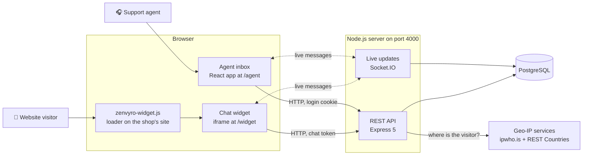
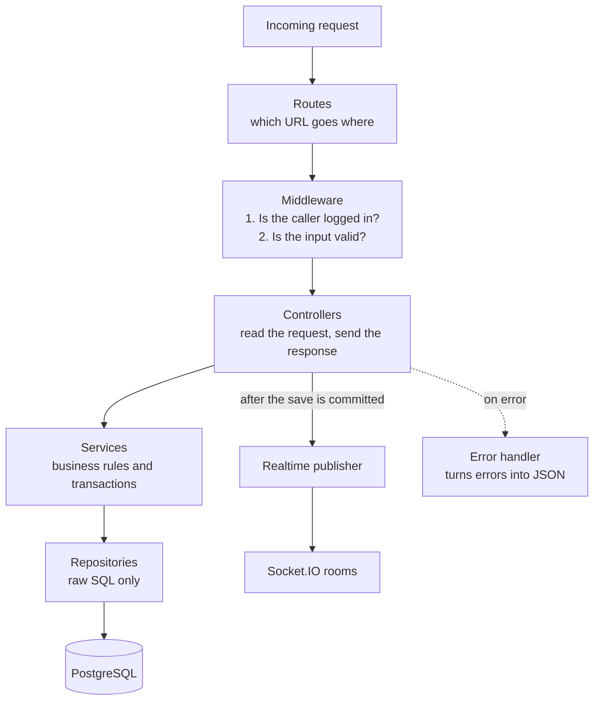
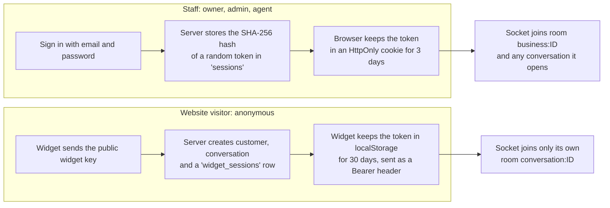
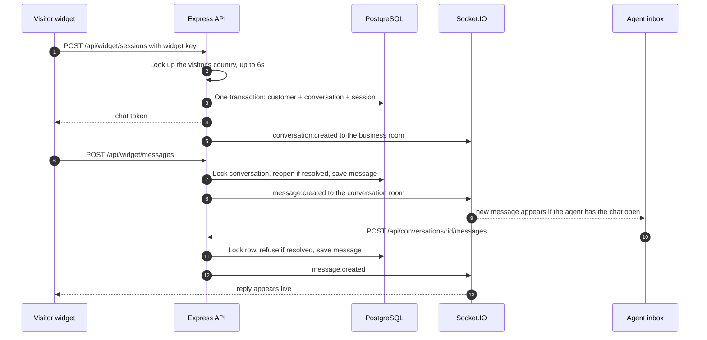
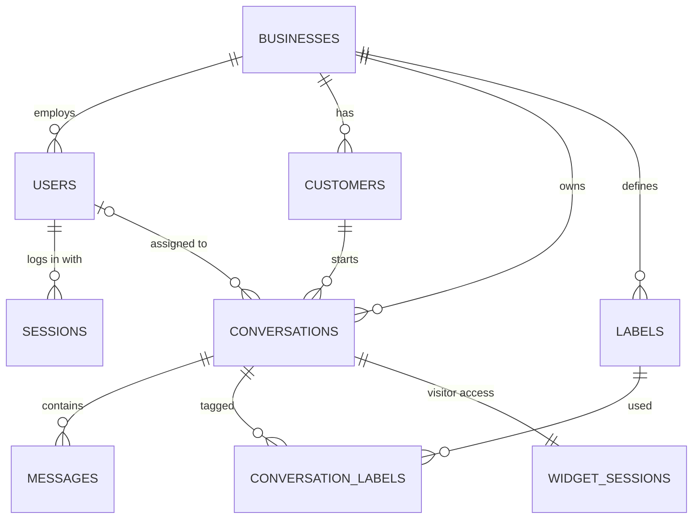
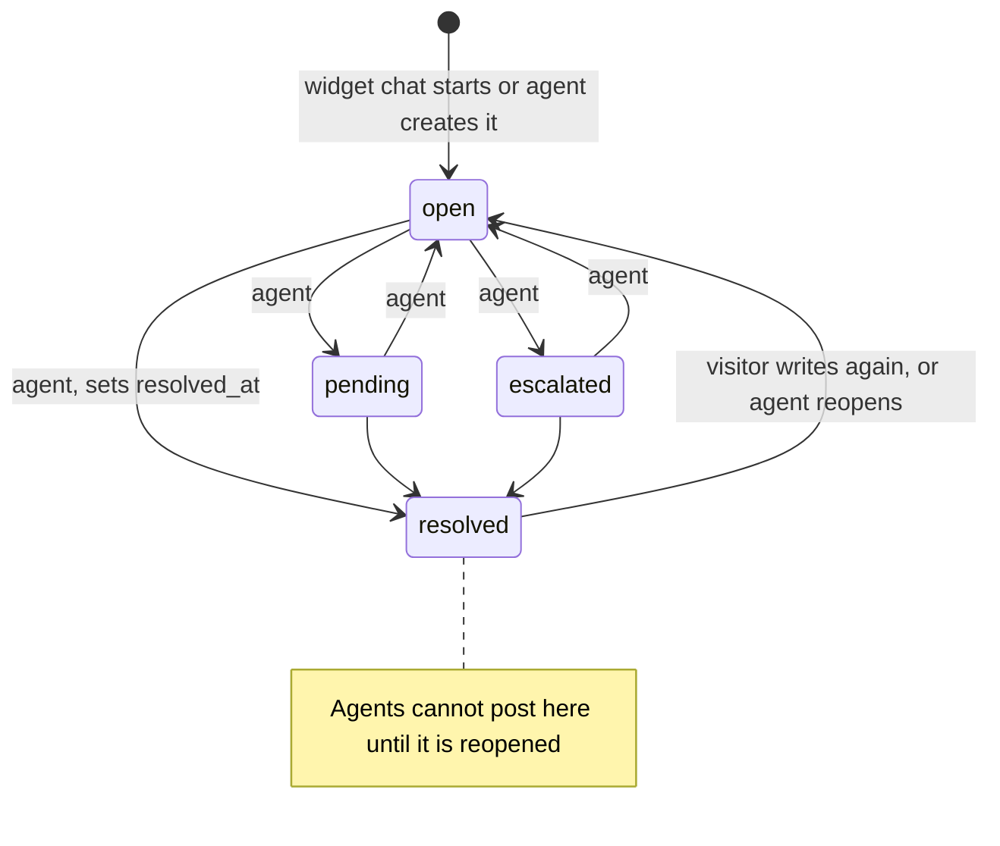

# Zenvyro architecture overview

High-level diagrams of how Zenvyro works today. For the detailed design (API reference, full ER diagram, planned AI flows), see [system-design.md](system-design.md).

1. [The big picture](#1-the-big-picture)
2. [Inside the backend: layers](#2-inside-the-backend-layers)
3. [Two kinds of users, two ways to log in](#3-two-kinds-of-users-two-ways-to-log-in)
4. [A message's journey](#4-a-messages-journey-visitor-writes-agent-replies)
5. [The data model](#5-the-data-model-tables-in-use-today)
6. [Conversation lifecycle](#6-conversation-lifecycle)

---

## 1. The big picture

## 2. Inside the backend: layers

## 3. Two kinds of users, two ways to log in

## 4. A message's journey: visitor writes, agent replies

## 5. The data model: tables in use today

These tables exist in `backend/db/schema.sql` but no code uses them yet: `teams`, `business_rules`, `knowledge_articles`, `message_verifications`, `ai_events`, `canned_responses`, `internal_notes`. They are reserved for the planned AI and Copilot features.

## 6. Conversation lifecycle

