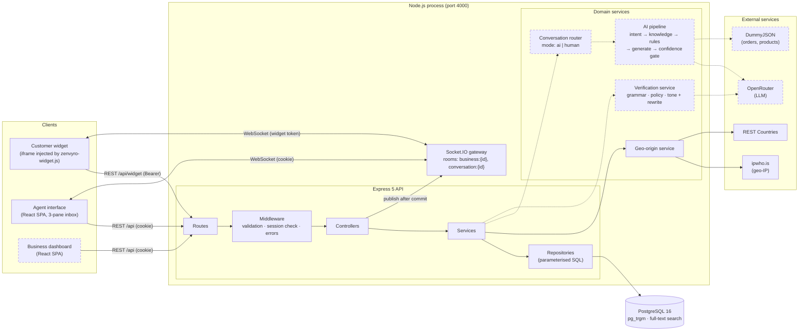
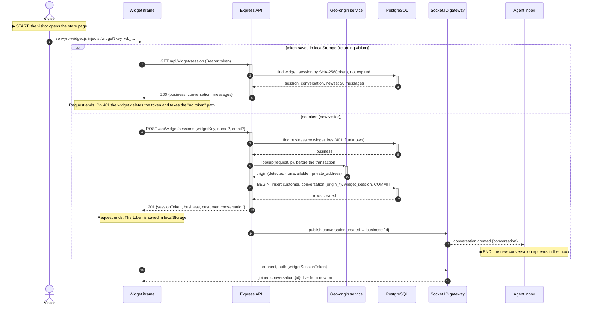
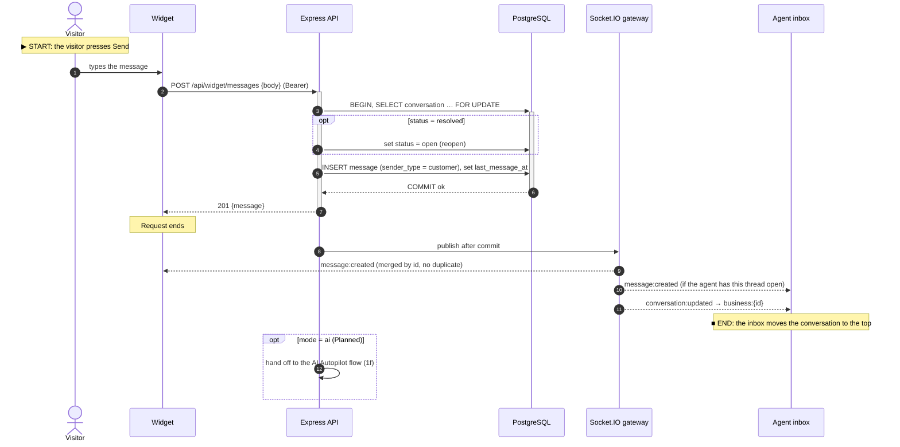
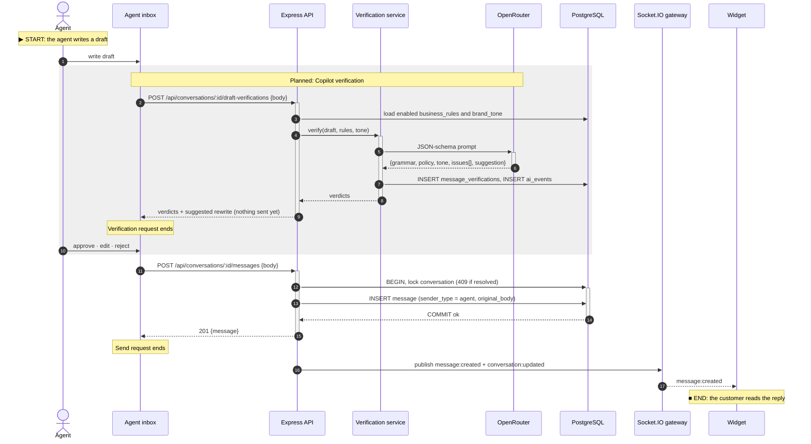
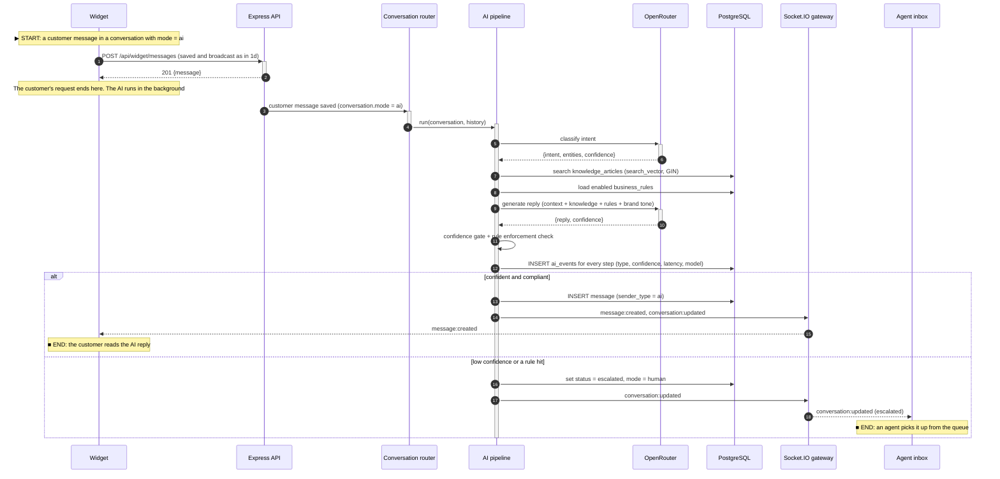
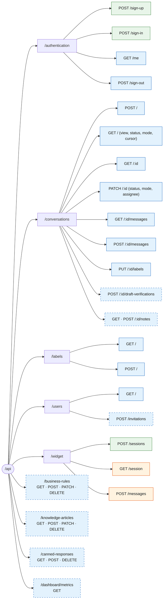
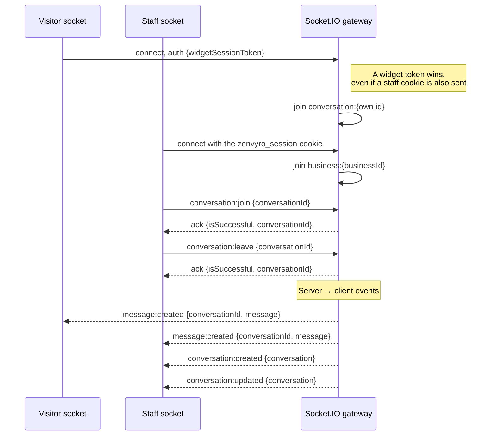
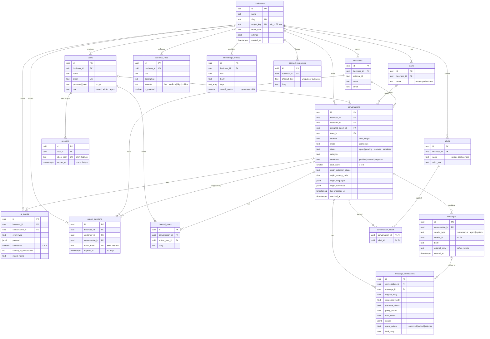
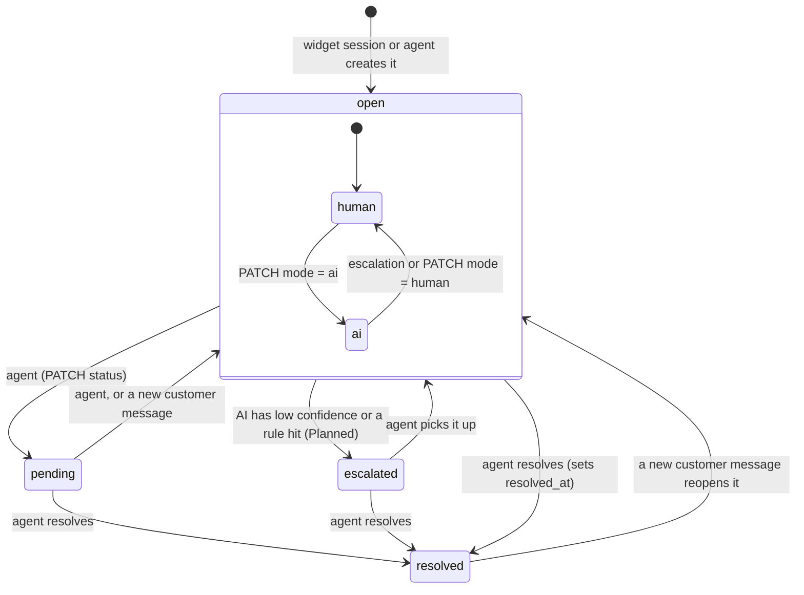

# Zenvyro system design

This document draws the [System design](../README.md#system-design) in diagrams. It covers three things:

1. [System design flow](#1-system-design-flow): the architecture and the main request flows.
2. [API design](#2-api-design): REST endpoints and the realtime (Socket.IO) contract.
3. [Database](#3-database): the entity-relationship diagram and the conversation lifecycle.

**Legend.** **Built** means the code exists today. **Planned** means it appears only in the README or roadmap, or as a table that no code uses yet. In flowcharts, planned parts have dashed borders.

---

## 1. System design flow

### 1a. Architecture

**Notes**

- The API and the Socket.IO gateway run in **one Node process**. Realtime events are published from controllers **after the database transaction commits**.
- There is no Redis adapter yet, so realtime works on a single instance only.
- The Business dashboard exists as a page. Its metrics API and its rule and knowledge management are Planned.

### 1b. Who starts each request, and where it ends

> **Animated version:** open [system-design-flows.html](system-design-flows.html) in a browser. Press Play to watch each request travel from sender to receiver, with a caption for every step.

How to read the diagrams below:

- **▶ START** marks who begins the flow.
- **■ END** marks the last thing that happens.
- A tall bar on a participant (an *activation*) shows how long that participant holds an open request. The bar begins when the request arrives and ends when the response leaves.
- Solid arrows (`->>`) are requests and events. Dashed arrows (`-->>`) are responses and pushed events.

| Flow | Started by | HTTP request ends | Flow ends |
|---|---|---|---|
| Widget starts a session (1c) | **Visitor's browser** loads the widget | `201 {sessionToken}` reaches the widget | **Agent inbox** receives `conversation:created` |
| Customer sends a message (1d) | **Visitor** presses Send | `201 {message}` reaches the widget | **Agent inbox** receives `conversation:updated` and re-sorts |
| Agent replies with Copilot (1e) | **Agent** writes a draft | Verification: verdicts reach the agent (Planned). Send: `201 {message}` | **Widget** receives `message:created`, and the customer reads the reply |
| AI Autopilot reply (1f) | **Customer's message** in a conversation with `mode = ai` | The customer's POST already returned. The AI runs afterwards | **Widget** shows the AI reply, or the **Agent inbox** shows the escalation |
| Staff signs in | **Agent** submits the sign-in form | `200` with the `zenvyro_session` cookie | The agent's socket joins `business:{id}` |

### 1c. Flow: the widget starts a session (Built)

### 1d. Flow: the customer sends a message (Built)

### 1e. Flow: the agent replies with Copilot verification

Sending the reply is Built. The verification steps in the shaded box are Planned.

### 1f. Flow: AI Autopilot reply (Planned)

---

## 2. API design

### 2a. Endpoint map

Colours show the auth type: **green** is public, **blue** needs the staff cookie `zenvyro_session`, and **orange** needs the widget Bearer token. Dashed boxes are Planned.

**Conventions**

- JSON over REST, under `/api`. Errors are returned as `{ "error": "…" }`, without SQL or stack details. Unknown routes return 404.
- Lists use **keyset cursors**, never offsets. `limit` defaults to 20, with a maximum of 50. The response is `{ items, nextCursor }`.
- Every staff query is scoped to the signed-in user's `business_id`. The widget is scoped by its token.
- CORS: `/api/widget` accepts any origin without credentials. Every other route needs an allowlisted origin and sends credentials.

### 2b. Endpoint reference

| Method | Path | Auth | Request | Response |
|---|---|---|---|---|
| POST | `/api/authentication/sign-up` | public | `{businessName, name, email, password}` | 201 `{user, business}`, sets cookie |
| POST | `/api/authentication/sign-in` | public | `{email, password}` | 200 `{user, business}`, sets cookie · 401 |
| GET | `/api/authentication/me` | cookie | none | 200 `{user, business}` |
| POST | `/api/authentication/sign-out` | cookie | none | 204, deletes the session |
| POST | `/api/conversations` | cookie | `{customerId}` or `{customer{name, email?, externalId?}}`, `firstMessageText?` | 201 `{conversation}` |
| GET | `/api/conversations` | cookie | `?view=all\|mine\|unassigned&status&mode&customerId&limit&cursor` | 200 `{conversations, nextCursor}` |
| GET | `/api/conversations/:id` | cookie | none | 200 `{conversation}` · 404 |
| PATCH | `/api/conversations/:id` | cookie | `{status?, mode?, assignedAgentId?}` | 200 `{conversation}` |
| GET | `/api/conversations/:id/messages` | cookie | `?limit&cursor` (pages toward older messages) | 200 `{messages, nextCursor}` |
| POST | `/api/conversations/:id/messages` | cookie | `{body}` (1–5000 characters) | 201 `{message}` · 409 if resolved |
| PUT | `/api/conversations/:id/labels` | cookie | `{labelIds}` (up to 20) | 200 `{conversation}` |
| GET | `/api/labels` | cookie | none | 200 `{labels}` |
| POST | `/api/labels` | cookie | `{name, colorHex?}` | 201 `{label}` · 409 for a duplicate name |
| GET | `/api/users` | cookie | none | 200 `{users}` |
| POST | `/api/widget/sessions` | public (`widgetKey`) | `{widgetKey, name?, email?}` | 201 `{sessionToken, business, customer, conversation}` |
| GET | `/api/widget/session` | Bearer | none | 200 `{business, conversation, messages}` · 401 |
| POST | `/api/widget/messages` | Bearer | `{body}` | 201 `{message}` |
| POST | `/api/conversations/:id/draft-verifications` | cookie | `{body}` | **Planned:** `{grammar, policy, tone, issues[], suggestion, verificationId}` |
| GET · POST · PATCH · DELETE | `/api/business-rules` | cookie | `{title, description, severity, isEnabled}` | **Planned** |
| GET · POST · PATCH · DELETE | `/api/knowledge-articles` | cookie | `{title, body, tags[]}`, search with `?q=` | **Planned** |
| GET · POST · DELETE | `/api/canned-responses` | cookie | `{shortcutText, body}` | **Planned** |
| GET · POST | `/api/conversations/:id/notes` | cookie | `{body}` | **Planned** |
| POST | `/api/users/invitations` | cookie (owner or admin) | `{email, role}` | **Planned** |
| GET | `/api/dashboard/metrics` | cookie | `?from&to` | **Planned** |

Every conversation object includes the customer's name and email, `labels[]`, `origin{…}` and `lastMessage{preview, senderType, createdAt}`.

### 2c. Realtime contract (Socket.IO)

| Direction | Event | Room or target | Payload |
|---|---|---|---|
| client → server | `conversation:join` | staff only, same business | `{conversationId}`, ack `{isSuccessful, conversationId \| error}` |
| client → server | `conversation:leave` | staff only | `{conversationId}`, ack as above |
| server → client | `message:created` | `conversation:{id}` | `{conversationId, message}` |
| server → client | `conversation:created` | `business:{id}` | `{conversation}` |
| server → client | `conversation:updated` | `business:{id}` | `{conversation}` |

---

## 3. Database

### 3a. Entity-relationship diagram

Source: [backend/db/schema.sql](../backend/db/schema.sql). All ids are `uuid` values generated by `gen_random_uuid()`.

| Status | Tables |
|---|---|
| **Built** (used by code) | `businesses`, `users`, `sessions`, `customers`, `conversations`, `messages`, `widget_sessions`, `labels`, `conversation_labels` |
| **Planned** (table exists, no code yet) | `teams`, `business_rules`, `knowledge_articles`, `message_verifications`, `ai_events`, `canned_responses`, `internal_notes` |

**Invariants**

- `businesses` is the tenant root. Every row of business data reaches a `business_id`, either directly or through its conversation.
- The widget creates exactly **one customer, one conversation and one widget session** per visitor. The schema allows more, so the service layer enforces this.
- Only SHA-256 hashes of session tokens are stored (`sessions`, `widget_sessions`). A database leak does not expose working sessions.
- `messages.original_body` keeps the text as it was before any compliance rewrite.

**Indexes**

- `conversations (business_id, last_message_at DESC, id DESC)`: inbox keyset pagination.
- `conversations (business_id, status)` and `conversations (business_id, assigned_agent_id)`: inbox filters.
- `messages (conversation_id, created_at)`: loading a thread.
- `knowledge_articles USING GIN (search_vector)`: knowledge base full-text search.
- `sessions (expires_at)` and `widget_sessions (expires_at)`: for a future job that deletes expired sessions.

### 3b. Conversation lifecycle

Agents cannot reply to a `resolved` conversation (the API returns 409), but a new customer message reopens it.
